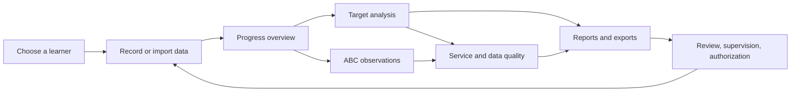
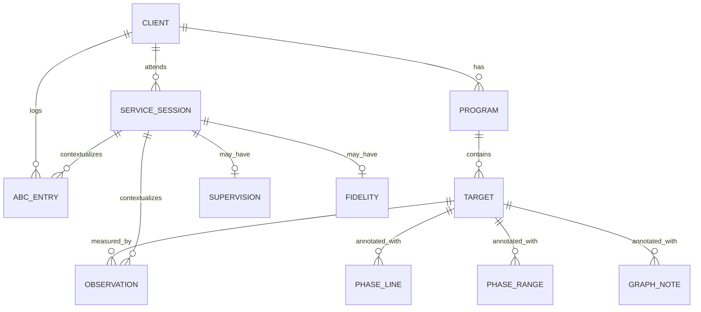
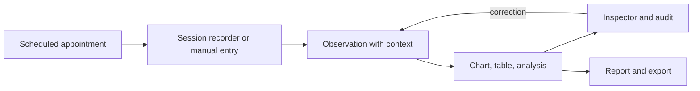

# Welina Analytics: Platform Wiki

**The complete guide to the features, science, and workflows of the Welina ABA analytics workspace.**

Welina is a fictional **Applied Behavior Analysis (ABA)** analytics workspace. It brings a learner's skill programs, behavior-reduction programs, session observations, ABC records, service delivery, and clinical paperwork into one place, and it explains the measurement science behind every number it shows.

> [!IMPORTANT]
> **This is a demonstration, not a patient-record system.**
> Every client, appointment, observation, and note in the workspace is simulated. Nothing is sent to a server, no account is required, and changes live only in the browser you are using. The analytics are decision *support* for fictional data, not a clinical determination, diagnosis, or treatment recommendation.

| | |
|---|---|
| **Snapshot date** | 14 October 2026 (the fictional "today") |
| **Demo history** | 26 weeks, 13 April to 14 October 2026 |
| **Demo content** | 5 fictional learners · 37 programs · 66 targets · 3,676 observations · 826 ABC records · 589 appointments · 12 staff |
| **Live demo** | <https://pkiran-aloha.github.io/ADC/> |
| **Source code** | <https://github.com/pkiran-aloha/ADC> |
| **Engineering reference** | [Tech Stack and Architecture](../../TECH_STACK.md) |

---

## Start here

There are three quick ways into this page.

| If you want to… | Read |
|---|---|
| **See the product in action** | [Part 2: The guided tour](#part-2-the-guided-tour) then [Part 5: The five workflows](#part-5-the-five-workflows) |
| **Understand what the numbers mean** | [Part 3: Core concepts](#part-3-core-concepts) then [Part 6: The science](#part-6-the-science) |
| **Look up a control or metric** | [Part 9: Reference](#part-9-reference) |

> [!TIP]
> **The one-sentence mental model:** a **client** has **programs**, each program contains **targets**, and each target is measured repeatedly by **observations** collected during **appointments**. Everything else in Welina is a way to record, check, analyze, annotate, or report those observations.

---

## How to use this wiki

- **New to ABA?** Read [Part 3](#part-3-core-concepts) and the [glossary](#94-glossary) first. Clinical terms are defined in plain language where they first matter.
- **A clinician?** Go straight to [Part 4](#part-4-getting-data-in) for recording rules and [Part 6](#part-6-the-science) for the analysis methods and their caveats.
- **Reviewing a graph with someone?** Use [Part 5](#part-5-the-five-workflows) as a walkthrough and [Part 6.3](#63-visual-analysis) for the six features and effect sizes.
- **An engineer or reviewer?** The [tech stack artifact](../../TECH_STACK.md) covers the architecture, dependencies, data pipeline, testing, and deployment.
- **Looking for a specific control?** [Part 9.2](#92-where-to-find-it) maps every job to the screen and control that does it.

> [!NOTE]
> This page describes the demo as it is built. Where the platform deliberately limits itself, the limitation is stated rather than hidden. A summary of what it does *not* claim is in [Part 8](#part-8-limits-and-trust).

---

## Contents

**Part 1: Getting oriented**
- [1.1 What Welina is](#11-what-welina-is)
- [1.2 What the platform is not](#12-what-the-platform-is-not)
- [1.3 The demo at a glance](#13-the-demo-at-a-glance)
- [1.4 The five workflows](#14-the-five-workflows)
- [1.5 The domain model in one picture](#15-the-domain-model-in-one-picture)

**Part 2: The guided tour**
- [2.1 Before you start](#21-before-you-start)
- [2.2 The 15-minute tour](#22-the-15-minute-tour)
- [2.3 Finding your way around](#23-finding-your-way-around)
- [2.4 Keyboard, mobile and accessibility](#24-keyboard-mobile-and-accessibility)

**Part 3: Core concepts**
- [3.1 Clients, programs and targets](#31-clients-programs-and-targets)
- [3.2 Phases and statuses](#32-phases-and-statuses)
- [3.3 Observations, sessions and context](#33-observations-sessions-and-context)
- [3.4 The six measurement tools](#34-the-six-measurement-tools)
- [3.5 Missing data, measured zero and not tracked](#35-missing-data-measured-zero-and-not-tracked)
- [3.6 Access levels](#36-access-levels)

**Part 4: Getting data in**
- [4.1 The four routes](#41-the-four-routes)
- [4.2 Record a whole session](#42-record-a-whole-session)
- [4.3 Record one target](#43-record-one-target)
- [4.4 Add a single data point](#44-add-a-single-data-point)
- [4.5 Import a spreadsheet](#45-import-a-spreadsheet)
- [4.6 Correct or remove an observation](#46-correct-or-remove-an-observation)
- [4.7 Annotate a graph](#47-annotate-a-graph)
- [4.8 Change a program status](#48-change-a-program-status)

**Part 5: The five workflows**
- [5.1 Progress overview](#51-progress-overview)
- [5.2 Target analysis](#52-target-analysis)
- [5.3 ABC observations](#53-abc-observations)
- [5.4 Service and data quality](#54-service-and-data-quality)
- [5.5 Reports](#55-reports)

**Part 6: The science**
- [6.1 ABA foundations](#61-aba-foundations)
- [6.2 Measurement science](#62-measurement-science)
- [6.3 Visual analysis](#63-visual-analysis)
- [6.4 Mastery and decision rules](#64-mastery-and-decision-rules)
- [6.5 ABC and functional thinking](#65-abc-and-functional-thinking)
- [6.6 Predictive models](#66-predictive-models)
- [6.7 Statistical notes and limitations](#67-statistical-notes-and-limitations)

**Part 7: Exports and reports**
- [7.1 Export surfaces](#71-export-surfaces)
- [7.2 Building a report](#72-building-a-report)
- [7.3 Formats and caveats](#73-formats-and-caveats)

**Part 8: Limits and trust**
- [8.1 What the demo deliberately does not do](#81-what-the-demo-deliberately-does-not-do)
- [8.2 Privacy, storage and accessibility](#82-privacy-storage-and-accessibility)
- [8.3 The clinical standards used](#83-the-clinical-standards-used)

**Part 9: Reference**
- [9.1 Data dictionary](#91-data-dictionary)
- [9.2 Where to find it](#92-where-to-find-it)
- [9.3 Export formats](#93-export-formats)
- [9.4 Glossary](#94-glossary)
- [9.5 Troubleshooting and FAQ](#95-troubleshooting-and-faq)
- [9.6 References](#96-references)
- [9.7 Related documents](#97-related-documents)

---

# Part 1: Getting oriented

## 1.1 What Welina is

Welina is a **single-case clinical analytics workspace**. It is built around the questions a behavior analyst asks between sessions:

1. **Where is this learner now?** How many programs are running, which targets are mastered, and what changed this week?
2. **Is this target actually changing?** What does the graph show, and does the change meet a defensible visual-analysis and effect-size standard?
3. **What is happening around the behavior?** Which antecedents, consequences, times, places, and setting events accompany problem behavior?
4. **Is the service and the measurement trustworthy?** Were the authorized hours delivered, was treatment implemented as written, and did a second observer agree?
5. **Can I share the evidence?** Can I produce graphs, a target roster, and a print-ready report without rebuilding them by hand?

The workspace answers those questions with five linked screens: **Progress overview**, **Target analysis**, **ABC observations**, **Service and data quality**, and **Reports**.

### Who it is for

| Role | What they use |
|---|---|
| **BCBA / BCaBA** | Program oversight, visual analysis, mastering targets, supervision and fidelity, authorization reports |
| **RBT / direct staff** | Whole-session recording, quick probe entry, knowing what is scheduled and what still needs documentation |
| **Clinical director** | Cross-program progress, graphing policy, data-quality coverage, service dosage |
| **Parent / caregiver reviewer** | Plain-language progress summaries and a target roster (in a real deployment, with the right permissions) |
| **Analyst / reviewer** | Transparent methods, formulas, thresholds, effect sizes, and exportable raw data |

### What makes it different from a spreadsheet

- **Measurement-aware.** The workspace knows the difference between a trial-by-trial percentage, an interval percentage, a duration, a frequency, and a fluency rate. It does not let a blank become a zero.
- **Context-aware.** Every point can carry its appointment, clinician, setting, service code, setting events, IOA check, supervision overlap, and procedural fidelity.
- **Analysis-aware.** Graphs come with stability envelopes, trend lines, non-overlap effect sizes, dual-criterion tests, celeration, and data-quality warnings.
- **Workflow-aware.** Recording, analysis, quality review, and reporting are separate jobs with separate screens, not one endless page.
- **Honest about uncertainty.** Forecasts show their validation error. Descriptive ABC data is labelled correlational. Small samples are called out.

## 1.2 What the platform is not

> [!WARNING]
> **Not a medical record, not a billing system, not a diagnostic tool, and not a substitute for supervision.**

| It is not… | Why it matters |
|---|---|
| **An EHR or patient-record system** | There is no application server in the deployed demo, no login, audit identity, encryption-at-rest, retention policy, or HIPAA/BAA posture. Do not enter real client information. |
| **A production multi-tenant service** | Data lives in this browser's `localStorage`; a different browser or device has a different copy. |
| **A functional analysis** | ABC records are descriptive. They can suggest a function hypothesis; they cannot confirm one. |
| **A statistical proof of causality** | Single-case visual analysis and effect sizes support clinical judgment. They do not establish experimental control without an appropriate design. |
| **A billing or authorization engine** | Hours, service codes, cancellations, and supervision are summarized for review; no claims are submitted. |
| **A decision-maker** | Every insight is a prompt. No program, target, phase, or status changes automatically from an analysis. |

## 1.3 The demo at a glance

The shared fixture, [`data/clinicalSeed.json`](../../data/clinicalSeed.json), is a deterministic simulated clinical dataset used by both the frontend and the .NET API.

| Dimension | Demo content |
|---|---|
| **Learners** | 5 fictional clients, ages 4–12, across comprehensive and focused service models, 7–25 authorized hours per week |
| **Settings** | Clinic, home, school, community, and telehealth |
| **History** | 26 weeks of recurring appointments with holidays, vacations, illness, cancellations, and substitute staff |
| **Appointments** | 589 service sessions: 547 completed, 42 cancelled; service codes 97153 (direct RBT treatment), 97155 (BCBA treatment / protocol modification), 97156 (caregiver guidance) |
| **Programs** | 37 total: 22 Skill Acquisition and 15 unitary Behavior Reduction programs |
| **Targets** | 66 targets spanning all six measurement tools and all eight phases |
| **Observations** | 3,676 rows, including 7,837 individually coded trials, 715 IOA checks, interval-by-interval scores, duration episodes, and fluency errors |
| **ABC records** | 826 entries, with 93 sessions carrying setting events |
| **Supervision** | 143 supervision overlaps with procedural-fidelity checklists, 12 staff (BCBA, BCaBA, RBT) |
| **Annotations** | 101 phase lines, 7 phase ranges, 8 graph notes |
| **Standards** | Organisation thresholds for IOA, fidelity, supervision, stability, non-overlap, dual-criterion, graphing, and behavior reduction |

The dataset is **simulated, not hand-typed**. A Python generator builds function-specific behavior episodes, prompt-by-prompt trial sequences, phase histories that agree with mastery rules, and appointment context, so the story on the graphs is internally consistent. The same file is embedded into the .NET API at build time.

> [!NOTE]
> The demo clock is not the real clock. "Today" is the latest recorded timestamp in the fixture, so the Session activity panel always has something to show.

## 1.4 The five workflows

The workspace opens one workflow at a time. Each is a naturally occurring job, not a feature category.



| Workflow | The question it answers | Main screens |
|---|---|---|
| **Progress overview** | Where does this learner stand today? | Client summary, metric strip, skill mastery chart, weekly progress map |
| **Target analysis** | Is this specific target changing, and why do I believe it? | Interactive chart, observation inspector, visual analysis, prompt and celeration views |
| **ABC observations** | What happens before, during, and after the behavior? | Timeline, patterns, scatterplot, flow, escalation chains, forecast |
| **Service and data quality** | Was the service delivered, measured reliably, and supervised? | Dosage, attendance, IOA, fidelity, cancellations, supervision, session activity |
| **Reports** | How do I share the evidence? | Report builder, target roster, print view, CSV/HTML exports |

The active workflow is reflected in the URL hash (`#overview`, `#target-analysis`, `#abc-observations`, `#service-quality`, `#reports`), so a link opens the right screen. Screens stay mounted when you switch, preserving filters and drill-down state.

## 1.5 The domain model in one picture



**Read it as a sentence:** a client attends appointments; appointments provide context for observations and ABC entries; programs contain targets; targets are measured by observations and described by phase annotations.

The rest of this page uses these terms precisely:

- A **client** (also **learner**) is the person whose programs are being analyzed.
- A **program** is a bundle of related goals, with one category: **Skill Acquisition** or **Behavior Reduction**. A Behavior Reduction program in this demo contains exactly one target.
- A **target** is one measurable skill or behavior. It has a measurement tool, a current phase, a phase history, and usually a mastery rule.
- An **observation** (also **data point**) is one measurement of one target at one timestamp.
- An **appointment** (also **service session**) is a scheduled service contact with a date, time, duration, staff member, service code, setting, and status.
- An **ABC entry** is a descriptive record of antecedents, behaviors, and consequences at a timestamp.
- An **annotation** is a phase line, phase range, or graph note attached to a target.

---

# Part 2: The guided tour

## 2.1 Before you start

1. Open the [live demo](https://pkiran-aloha.github.io/ADC/).
2. The workspace opens on **Liam Miller** (`cli-liam`) and **Progress overview**.
3. Keep **Full editing** in the header **Access** selector so every control is available.
4. If the data look unfamiliar, choose **Reset demo data** in the sidebar footer and confirm **Restore demo data**. Only this browser is affected.

> [!TIP]
> Use **Access → View-only analytics** at any time to see what a reviewer sees: every graph, table, analysis, and export stays available, while recording, correcting, annotating, axis settings, and status changes are disabled.

## 2.2 The 15-minute tour

Follow these steps in order. Each one produces something visible.

| # | Do this | You should see | Why it matters |
|---|---|---|---|
| 1 | Read the header: **Current client**, **Add data**, **Import**, **Record observation**, **Access** | One learner is selected and data actions are enabled | Everything is scoped to one learner at a time |
| 2 | Look at the metric strip | Programs, targets mastered, session observations, ABC observations | These counts come from the actual fixture, not marketing copy |
| 3 | In **Skill mastery**, choose a program | A cumulative line of mastery transitions, with the targets mastered on each date | Mastery is counted from the *first* entry into Maintenance, Generalization, or Completed |
| 4 | Scroll to **Weekly progress map** | Targets × the last 12 weeks; darker cells are closer to the goal | This is the fastest way to find a target that is stuck or accelerating |
| 5 | Select any map cell | The workspace opens **Target analysis** on that target, week, and weekly grouping, with details open | Summary views drill into the evidence, not into a dead end |
| 6 | In **Target analysis**, change **Group by** from **Weekly** to **Day**, then **Session** | Data points regroup; per-session view paginates 12 groups at a time | Aggregation changes what a "point" means; the units stay explicit |
| 7 | Hover a point, then press Enter or click it | A tooltip first; then the **Observation details** inspector opens | Keyboard and pointer both reach the underlying session |
| 8 | In the inspector, open a session | Measurement, clinician and role, appointment, setting events, IOA, supervision, fidelity, prompt chips or interval grid, ABC records | A graph point is not an orphan number; it has provenance |
| 9 | Scroll to **Visual analysis** | Phase comparison, effect sizes, dual-criterion, progress and decision prompts, data quality, context | The platform quantifies what a clinician would inspect by eye |
| 10 | Open **ABC observations → Patterns** | Antecedent × behavior and consequence × behavior matrices, function profile, scatterplot, flow, chains | Descriptive functional thinking, with the correlational caveat stated |
| 11 | Open **ABC observations → Forecast** | Next-session outlook, model check, two-week outlook, situation explorer | Every forecast reports how it performed on later data it never saw |
| 12 | Open **Service & data quality** | Dosage, attendance, IOA, fidelity, supervision, cancellations, live session activity | A graph is only as trustworthy as the service and measurement behind it |
| 13 | Open **Reports** | Template, program scope, date range, target roster | One document can carry every selected graph and the goal list |
| 14 | Choose **Download report** | A standalone HTML document opens or downloads | The report is self-contained and print-ready |
| 15 | Try **Access → View-only analytics** | Data actions disable; graphs and exports remain | Role-based read-only access is a first-class workflow |

## 2.3 Finding your way around

| Region | What lives there |
|---|---|
| **Header** | Brand, current-client selector, **Add data**, **Import**, **Record observation**, **Access**, **Reset demo data** |
| **Workflow tabs** | The five workflows, with keyboard tab semantics and a snapshot chip (client · observations · targets · week · sources) |
| **Sidebar** | Workspace navigation, data actions, access selector (mobile), reading tips, demo scope, reset, project link |
| **Main workspace** | The active workflow. Each workflow is its own screen with a heading, controls, content, and footnotes |
| **Dialogs** | Recording, manual entry/import, annotation editors, reset confirmation, mobile navigation |

On phones, the sidebar becomes a keyboard-accessible drawer and the workflow tabs become a horizontal scroller. The header collapses secondary actions into the drawer below the tablet breakpoint.

## 2.4 Keyboard, mobile and accessibility

- **Workflow tabs:** arrow keys move between tabs; Home and End jump to the first and last tab.
- **Chart points:** Tab reaches the chart, arrow keys move a crosshair, Home/End jump to the first/last point, Enter/Space opens the inspector, and Escape closes it.
- **Dialogs:** native modal behavior, focus trap, Escape to close, focus restoration, and background scrolling locked.
- **Tables:** horizontally scrollable regions are focusable and named, so keyboard users can reach every column.
- **Motion:** reduced-motion preference is respected for scrolling and transitions.
- **Targets:** interactive controls meet a 44px touch target; status is not conveyed by color alone.
- **Nonvisual equivalents:** every chart has a data table or a narrative alternative; heat-map cells and chart points are buttons with descriptive labels.

> [!NOTE]
> The browser suite runs axe WCAG A/AA checks on selected states, but automated checks are not an accessibility certification. See [Part 8.2](#82-privacy-storage-and-accessibility).

---

# Part 3: Core concepts

## 3.1 Clients, programs and targets

### Client

A client record contains a name, code, date of birth, diagnosis, supervising clinician, location, service model, authorized hours per week, start date, and primary setting. In the demo all five clients have an autism spectrum diagnosis (with different descriptors, such as Level 1–3 or co-occurring ADHD), but the platform itself does not assume a diagnosis.

### Program

A program is either **Skill Acquisition** or **Behavior Reduction**. It carries:

- a name, domain, treatment area, description, objective, teaching instructions, and baseline description;
- a current status and status history;
- tags, custom fields, and downloadable learning materials;
- one or more targets.

Behavior Reduction programs in the demo are **unitary**: exactly one target per program. This keeps behavior comparison and reduction rules unambiguous.

### Target

A target is the unit of measurement and analysis. It carries:

| Field | Meaning |
|---|---|
| **Name and description** | What is taught or reduced, in observable terms |
| **Type** | Trial by trial, Duration, Frequency, Interval data, Anecdotal, or Fluency / rate |
| **Phase** | Current lifecycle stage (Baseline, Acquisition, Maintenance, Generalization, Completed, On hold, Discontinued, Pending) |
| **Phase history** | Every dated phase transition, kept chronological |
| **Discriminative stimuli** | The cue that should occasion the response |
| **Prompt hierarchy** | The ordered prompt levels and one-letter codes used in trial coding |
| **Interval / fluency settings** | Interval length, capture type, number of intervals, timer start |
| **Mastery settings and rule** | Manual or automatic promotion, plus the structured rule |
| **Function hypothesis and intervention** | Behavior Reduction only: the documented FBA hypothesis and plan |
| **Reduction rule** | Optional per-target override of the organisation's behavior-reduction criterion |

### Why the target matters

Every graph, effect size, mastery evaluation, and report chart is computed **per target**. Programs are organizational containers; targets are the analytical unit. When a clinician says "the data are improving," the platform asks: *which target, measured with which tool, grouped how, compared with which condition?*

## 3.2 Phases and statuses

A target's **phase** describes where it is in the teaching or reduction lifecycle. The demo uses all eight phases.

| Phase | Plain meaning | Typical next step |
|---|---|---|
| **Pending** | Approved but not started | Confirm baseline and start date |
| **Baseline** | Measuring before intervention | Collect stable baseline, then begin teaching |
| **Acquisition** | Actively teaching | Monitor trend, prompt level, and fidelity |
| **Maintenance** | Criterion met; skill kept under periodic review | Probe periodically; reduce contrived reinforcement |
| **Generalization** | Testing or training across settings, people, and stimuli | Program common stimuli; train exemplars |
| **Completed** | Finished and withdrawn from the active plan | Archive or review at reassessment |
| **On hold** | Paused by the supervisor | Document the reason and review date |
| **Discontinued** | Withdrawn from the plan | Document rationale and any replacement goal |

**Program status** is a separate, program-level label: Teaching, Maintaining, Generalizing, Baselining, `OnHold` (the stored value; the target phase of the same name is shown as "On hold"), Completed, or Discontinued. Changing program status from **Progress and decisions** writes a dated entry to the program's status history with an optional reason; it does not rewrite target phases.

> [!IMPORTANT]
> A phase change and a program-status change are different actions. A target moves through Baseline → Acquisition → Maintenance; a program's overall status summarizes the plan. The demo's phase histories are generated so that automatic promotions agree with each target's mastery rule.

## 3.3 Observations, sessions and context

An **observation** is one measurement of one target. It can carry:

| Group | Fields |
|---|---|
| **Identity** | `id`, `clientId`, `targetId`, `timestamp`, `sessionNumber` |
| **Measurement** | `value`, `correctCount`, `totalTrials`, `occurredIntervals`, `totalIntervals`, `durationSeconds`, `occurrenceCount`, `lessonDurationMinutes`, `qualitativeEntry`, `errorCount` |
| **Clinical detail** | `trialSequence`, `intervalScores`, `episodeDurations`, `ioa` |
| **Context** | `serviceSessionId`, `dataSource`, `collectionContext`, `enteredManually`, `note` |
| **Semantics** | `missingDataMode`: Tracked, ZeroOut, or DataNotTracked |
| **Audit** | `editHistory`, `correctedAt`, `billedAfterService` |

An **appointment** (service session) is the context record: date, start/end, minutes, therapist, role, service code, setting, status, cancellation reason, setting events, supervision record, fidelity record, and IOA observer. The observation inspector joins the two so a point can be read in its real-world context.

The word **session** is overloaded in clinical work. In this wiki:

- **Appointment** or **service session** means the scheduled service contact.
- **Observation session** means one measurement occasion for a target.
- **Recording session** means one save from the session recorder, which may create observations for many targets at once.

### The life of a data point



## 3.4 The six measurement tools

The measurement tool determines what a number means, how it is aggregated, and which analyses are valid.

| Tool | What the clinician records | Stored as | Charted as | Notes |
|---|---|---|---|---|
| **Trial by trial** | Correct trials and total trials | `correctCount`, `totalTrials`, `value` = weighted % | **% correct** | Aggregation sums numerators and denominators, so 8/10 + 9/10 is 17/20 = 85%, not the average of 80% and 90% |
| **Interval data** | Intervals scored and total intervals | `occurredIntervals`, `totalIntervals`, `value` = % | **% of intervals** | Capture type (whole, partial, momentary time sampling) changes what the percentage means |
| **Duration** | Total seconds (and episodes in the fixture) | `durationSeconds`, `occurrenceCount`, `episodeDurations` | Total duration, occurrence count, or average duration | A duration of 0 can be a measured zero; episodes are separate events |
| **Frequency** | Occurrences and observation minutes | `occurrenceCount`, `lessonDurationMinutes` | Occurrence count, rate per minute, or rate per hour | Rate needs the observation window; the platform never invents a denominator |
| **Fluency / rate** | Correct responses, errors, and timing minutes | `occurrenceCount`, `errorCount`, `lessonDurationMinutes` | Rate per minute/hour/day, or a celeration chart | Designed for brief timings; the celeration view shows corrects, errors, and the record floor |
| **Anecdotal** | Narrative observation | `qualitativeEntry` | A table, not a plotted line | Useful context; not a quantitative measure |

> [!TIP]
> **Why weighted percentages matter.** Averaging two session percentages gives a small session the same weight as a large one. The platform aggregates raw counts first, then divides, so the percentage reflects the actual number of trials or intervals observed.

### Measurement settings you will see

- **Interval capture type:** whole interval (behavior must occur throughout), partial interval (behavior occurs at any point), or momentary time sampling (behavior is scored at the end of the interval).
- **Interval length and count:** for example, 30 seconds × 20 intervals. The recorder can prefill the configured count.
- **Timer start:** lesson start, manual start, count up, or count down, for fluency timings.
- **Prompt hierarchy:** least-to-most (Independent → Gestural → Model → Partial physical → Full physical), most-to-least with errorless fading, or verbal fading (Full verbal → Partial verbal → Initial sound → Independent).

## 3.5 Missing data, measured zero and not tracked

This distinction is one of the most important in the platform.

| State | Meaning | On graphs | In analytics | In raw exports |
|---|---|---|---|---|
| **Tracked / measured** | The behavior or skill was observed and measured | Plotted at its value | Included | Included |
| **ZeroOut** | The behavior was observed and did **not** occur; the zero is a real measurement | Plotted at 0 | Included | Included |
| **DataNotTracked** | No measurement was made | Omitted (never plotted as 0) | Excluded from totals and analyses | Retained, so the absence is visible |

Rules enforced by the interface:

- A blank field is **not** converted to zero.
- On a behavior-reduction target, the recorder asks **Observed** vs **Not tracked**. **Observed** with a count of 0 creates a genuine measured zero; **Not tracked** creates a missing record.
- Validation rejects negative values, fractional counts, correct trials above total trials, scored intervals above total intervals, and interval counts that do not match the configured number.
- **Include measured zeros** on a behavior chart can hide `ZeroOut` rows when you want to inspect only occurrences; `DataNotTracked` is always absent from analytics.
- Reports state the graphing policy and how many observations in range fall below the trial floor; raw exports keep those rows, so a display omission is never a data loss.

> [!WARNING]
> Do not use "0" to mean "I did not collect data." That single habit can make a behavior look mastered when it was simply not measured.

## 3.6 Access levels

The **Access** selector demonstrates role-based analytics. The setting is stored in this browser and applies to all five workflows.

| Capability | Full editing | View-only analytics |
|---|:---:|:---:|
| View graphs, tables, analyses | Yes | Yes |
| Export CSV, SVG, PNG, ZIP, reports | Yes | Yes |
| Record observations | Yes | No |
| Add a manual data point | Yes | No |
| Import a spreadsheet | Yes | No |
| Correct or delete an observation | Yes | No |
| Add, edit, or delete phase lines, ranges, notes | Yes | No |
| Change the axis range or graph view | Yes | No |
| Change program status | Yes | No |
| Reset demo data | Yes | No |

View-only mode is not a cosmetic toggle: disabled controls are not rendered as active interactions, the workspace explains why, and a one-click **Switch to full access** returns to editing. The demo does not simulate separate user accounts, so this is a role demonstration rather than real authorization.

> [!NOTE]
> The demo has no authentication. Anyone with the browser profile can switch access levels. In a production system, permissions would be enforced server-side, not by a selector.

---

# Part 4: Getting data in

## 4.1 The four routes

Data reaches a graph through one of four routes. They share the same validation and the same browser-local store.

| Route | Best for | Where | What it creates |
|---|---|---|---|
| **Session recorder** | A treatment session covering several targets | **Record observation** in the header | One observation per ticked target, with a shared date and clinician |
| **Single-target recorder** | A quick standalone record | **Record observation → Single target** | One observation for one target |
| **Manual entry** | Probes, school data, paper sheets, assessments, historical data | **Add data** in the header or sidebar | One observation with a collection source |
| **Spreadsheet import** | Many historical or external rows at once | **Import** in the header, or **Add data → Import spreadsheet** | Validated observations with import context |

> [!IMPORTANT]
> All four routes are disabled in **View-only analytics** mode. The demo seed itself is not a route: it is the starting dataset, and **Reset demo data** restores it.

## 4.2 Record a whole session

**Goal:** record every target you worked on in one pass, without opening each target separately.

1. Select the client.
2. Choose **Record observation**.
3. Keep **Whole program** selected.
4. Set the **Session date & time** and **Recording clinician**. Both apply to every row.
5. Optionally set **Session length (minutes)** and choose **Apply minutes to all rows**. This fills the observation window for frequency and fluency rows.
6. Choose a **Program**, or **All programs**.
7. Tick the targets you worked on. Every target in the program appears; unticked targets are left untouched.
8. Fill in the measurement fields for each ticked row. The inline preview shows the value that will be saved (for example, "80% accuracy · 8 / 10 trials").
9. Optionally choose a **Phase change** for a row. This updates the target's phase and adds a labelled phase line on the session date.
10. Choose one of:
    - **Save N observations** closes the dialog and writes the records.
    - **Save & next session** keeps the sheet open, clears the measurements (it keeps the trial count, interval count, and minutes as defaults), and moves the date to the client's next appointment at the same time, or to the next day.

Useful shortcuts:

- **Copy last session** refills each selected row from that target's most recent observation, including the previous correct/total trials and observation minutes. Review every copied value and change anything that differs before saving.
- **Select all** / **Clear** manage the target set.
- The clinician, program, and target set are remembered per client, so the next session is faster.

> [!NOTE]
> For a behavior-reduction row, answer **Was [target] observed?** before typing a count. **Observed** means 0 is a real measured zero. **Not tracked** means no measurement was made and the record is saved as missing.

### Validation rules in the recorder

| Field | Rule |
|---|---|
| Session date and time | Required; must be a real date and time |
| Recording clinician | Required |
| Trial by trial | Correct trials ≥ 0, total trials ≥ 1, correct ≤ total |
| Interval data | Scored intervals ≥ 0, total ≥ 1, scored ≤ total, total must match the configured interval count when one exists |
| Duration | Whole seconds ≥ 0 |
| Frequency / fluency | Occurrences ≥ 0; observation minutes > 0 |
| Anecdotal | Non-empty narrative |
| Not tracked | Measurement fields are disabled and the row is valid without a value |

The first invalid field receives focus and is announced. Nothing is saved partially.

## 4.3 Record one target

Use **Single target** when you only need one observation:

1. Choose **Record observation → Single target**.
2. Choose the **Program & target**.
3. Set the shared date and clinician (the session length field applies if relevant).
4. Fill in the measurement.
5. Save.

Single-target mode is the same validation and storage path as whole-session recording, so the resulting point is indistinguishable on the graph.

## 4.4 Add a single data point

**Add data** is for observations that did not come from a treatment session note: a cold probe, a school-collected data sheet, a paper record entered later, an assessment, or a historical transfer.

1. Choose **Add data**.
2. Select the **Target**.
3. Choose **Where the data came from**:

| Source | Use it for |
|---|---|
| **Probe / cold probe** | Brief probe sessions outside treatment |
| **School or classroom** | Data collected by school staff |
| **Paper data sheet** | Offline or paper workflow entered later |
| **Assessment** | Standardized or curriculum-based assessment |
| **Historical import** | Transferred from a previous provider or system |
| **Session recording** | Treatment session data entered manually |

4. Enter the **Date collected** and **Time**. The timestamp is not decoration: it powers the time-of-day ABC analysis.
5. Enter **Collected by** (name and role).
6. Fill in the measurement values.
7. Add an optional note.
8. For a behavior target, tick **Not measured in this observation** if no measurement was made. The toggle appears only for behavior-reduction targets.
9. Choose **Add to graph** to save and close, or **Save & add another** to keep the form open for the next point. A running list shows what you added in this session.

The point is stamped with `dataSource`, `collectionContext`, and `enteredManually: true`, so the graph, inspector, report, and raw export can distinguish it from a session recording. It appears on the same graph as recorded sessions.

## 4.5 Import a spreadsheet

**Goal:** bring in many rows from a CSV, TSV, or pasted table without hand-entering them.

1. Choose **Import** in the header, or **Add data → Import spreadsheet**.
2. Paste rows from the spreadsheet, or choose a CSV, TSV, or TXT file.
3. The importer matches columns by name. Set a **Default source for rows without one**, and optionally a **Collected by** name that overrides the file.
4. Check the preview: counts for **Rows found**, **Ready to import**, **Rows with problems**, **Targets matched**, and the date range, plus a table of the first 40 rows with line number, date, target, values, source, and status (a problem row shows its error text and is tinted).
5. Fix the source file and re-load it, or download **Rows to fix (n)** to get just the problem rows with their errors.
6. Choose **Import n rows** to add only the valid rows.

### Supported columns and aliases

| Field | Recognized aliases (examples) |
|---|---|
| **Date** (required) | date, observation date, session date, day, data date, date collected |
| **Time** | time, start time, clock time |
| **Target** (required) | target, target name, program, skill, behavior, goal |
| **Correct trials** | correct, correct trials, correct responses, independent, successes |
| **Total trials** | total, total trials, trials, opportunities |
| **Intervals scored** | scored, intervals scored, occurred intervals, occurrences scored |
| **Total intervals** | intervals, total intervals, interval count |
| **Duration (seconds)** | duration, duration seconds, seconds, total duration |
| **Occurrences** | occurrence count, frequency, count, episodes, occurrences |
| **Observation minutes** | minutes, observation minutes, lesson minutes, session length |
| **Value / percent** | value, percent, percentage, accuracy, score, rate |
| **Source** | source, collection, context, data source, setting |
| **Collected by** | clinician, therapist, rbt, staff, recorder, collector, collected by, data collector |
| **Note** | note, notes, comment, comments, context note |

Headers are matched on letters and digits only, so `DurationSeconds` and `Duration seconds` match. Exact matches win, then prefix matches, then contains matches.

### Assumptions the importer states

- If a trial-by-trial row has only a percentage and no trial counts, it assumes **10 trials** and records that assumption as a row note.
- If a frequency or fluency row has no observation minutes, it assumes **30 minutes** for frequency and **1 minute** for fluency, and records the assumption.
- A row with an unrecognized source, invalid date, unknown target, or invalid measurement is not imported; fields that the matched target does not use are ignored with a note.
- Imported rows carry their source and context, so they can be filtered or exported later.

Use **Download template** to get a CSV with the client's targets and the expected columns — one sample row per target type, up to 40 targets. `import_rows_to_fix.csv` lists line, target, date, and problem for each rejected row; it is a report, not a re-importable file, so fix the original and load it again. `pointsFromImport` writes the records through the same observation path as manual entry.

## 4.6 Correct or remove an observation

Data correction is a normal clinical event, not an exception.

1. Open the relevant graph point (click, or focus the chart and press Enter).
2. In **Observation details**, choose **Correct this observation**, or **Delete** to remove it.
3. Choose a **Reason** from Recording error, Transcription or typo, Wrong target selected, Duplicate entry, Probe recorded as a session, Data-sheet correction, Post-billing correction, or Other. **Other** requires a note that explains it.
4. Add a **Note for the audit trail** and **Your name and role**.
5. Choose **Save correction**, or **Remove observation**. The delete form also offers **Keep the observation** as its cancel.

A corrected point keeps a **Change history** block in its inspector: each entry shows the action, the reason, who, when, the before → after value, and whether the appointment had already been billed.

What happens:

- **Correction** replaces the measurement, keeps the previous values in `editHistory`, and records the reason, staff member, timestamp, and whether the appointment was already billed. The chart and tables use the corrected value immediately.
- **Removal** deletes the observation from the chart and totals and writes an entry to the browser's deletion audit: what was removed, why, by whom, and when, plus the measurement values that were lost. The newest entries are kept (up to 500). The inspector's delete form says the entry "stays in the client's change history", but in this build the audit has no screen and is not exported — treat that hint as describing the stored record, not a view you can open.
- **Post-billing changes** are flagged **Post-billing change**. The demo's policy is that the appointment does not need to be released and rebilled; the audit entry documents the correction instead.
- **Second-observer (IOA)** and **BCBA supervision** observations are stored with the session and **excluded** from the learner's chart totals. Correcting or removing a primary point does not change an agreement check.

> [!WARNING]
> Deletion is permanent in this browser. There is no undo button. Export the raw data first if the record may be needed.

## 4.7 Annotate a graph

Annotations explain a graph without changing the data. There are three kinds.

| Annotation | What it draws | Typical use |
|---|---|---|
| **Phase line** | A vertical divider and a label in the condition strip | "Teaching begins", "Intervention: blocking", a procedure change |
| **Phase range** | A shaded band across a date range | A vacation, a medication trial, a specific intervention window |
| **Graph note** | A labelled note attached to a date, drawn in staggered rows with a leader line | "Parent reported illness", "New RBT started", "Reinforcer changed" |

To add one:

1. In **Target analysis**, choose the target in the annotation selector.
2. Choose **Phase line**, **Phase range**, or **Note**.
3. Enter the date (or range), label, and color.
4. Choose **Apply to**:
   - this target only,
   - the other targets in the same program, or
   - every target (from the quick action).
5. Save.

Each target keeps its own copy. Duplicate annotations on the same target/date are skipped, and the confirmation reports how many targets were updated and how many already had it. Phase lines and notes also travel into exported SVG and report charts. Automated phase lines from phase changes are labelled **automated** and are not duplicated by manual lines.

Existing annotations are listed under the chart. Use the pencil icon to edit one or the trash icon to delete it; both actions apply to that target's copy only.

> [!TIP]
> Use a phase line for a *condition change* and a graph note for *context*. Keeping those roles separate makes the visual analysis easier to defend.

## 4.8 Change a program status

When the data show that a program should continue, pause, or move on:

1. Open **Target analysis → Visual analysis → Progress and decisions**.
2. Scroll to **Program status · <program name>**. It shows the current status and the date of the last change.
3. Choose Teaching, Maintaining, Generalizing, Baselining, `OnHold`, Completed, or Discontinued from **Update status after reviewing this data**. The menu lists the stored status names in that fixed order, so **OnHold** appears without a space.
4. Add an optional **Reason** (up to 120 characters).
5. Choose **Update program status** and read the inline confirmation.

The change is written to the program's status history as a `{status, date, reason, staffName, note}` entry with the demo snapshot date (`asOf: SEED_AS_OF_DATE`), not the wall clock. This control sends only the reason, so `staffName` and `note` stay empty for status changes made here. The panel displays only the latest entry ("last changed …"); earlier entries remain in the stored program but have no list view. It does not rewrite target phases — only the recorder's **Phase change** field moves a target; a phase line is an annotation and leaves `phase` untouched.

---

# Part 5: The five workflows

## 5.1 Progress overview

**Question:** Where does this learner stand today?

### Client summary and metric strip

The opening screen shows the selected learner's identity, supervising clinician, and four counts derived from the actual data:

- **Programs** — total, split into skill and behavior programs.
- **Targets mastered** — skill targets currently in Maintenance, Generalization, or Completed.
- **Session observations** — all observation rows for the learner.
- **ABC observations** — all ABC records for the learner.

If no client is selected, the workspace shows a client-choice state and disables the other workflows. The client selector in the header is the single source of scope; changing it keeps each screen's state but re-filters all data.

### Portfolio triage

Directly below the metric strip, the portfolio triage answers the analysis-first question — *what is improving, what needs me, and what changed?* — without opening programs one at a time. It is a read-only rollup over the existing client → program → target structure; it adds no entities and changes no data.

- **KPI strip (last 90 days).** Five cards summarize every measured target: **Improving**, **Stable** and **Declining** show a percentage and item count, then **Near mastery** and **Needs review** show counts. Trend percentages use only *active* targets with at least four weekly points; maintenance, generalization, completed, paused and discontinued targets are reported with their own status pills instead of entering the trend denominator. For behavior-reduction targets, a decreasing measure reads as **improving** — direction always follows the target's therapeutic direction, not the raw sign of the number.
- **Clinical attention center.** Ranked cards combine the leading concern (wrong-direction trend, plateau, high variability, stale data, no data, or regression after mastery) with a 12-week sparkline and the reason in words. Selecting a card opens that target's chart in **Target analysis** through the same focus mechanism the weekly progress map uses.
- **Recent successes.** Mastery transitions into maintenance, generalization or completed from the last 30 days, taken from each target's existing phase history. **Use in report** switches to the Reports workflow with the learner still selected.
- **Target health matrix.** One keyboard-operable row per measured target: measurement type, 90-day trend delta, phase status, a forecast (criterion streak like `2/3 at criterion`, a projected horizon, or *Review needed*) and a current-level bar against the mastery criterion when the units match. Selecting a row — with a pointer, Enter or Space — opens the target analysis for that target.
- **KPI cards are filters.** Selecting Improving, Stable, Declining, Near mastery or Needs review filters the matrix to the items behind that number; selecting the card again or **Clear filter** restores the full list.

**How the classifications are made.** Weekly observations are aggregated in each tool's natural unit (the same normalization as the progress map), an ordinary least-squares fit is run over the last 12 weekly points, and a fitted relative change under 10% reads as stable. Variability requires both a failed ±25% stability envelope and a coefficient spread of at least 0.25, so ordinary weekly noise is not over-flagged. Near mastery means the mastery streak is one session short or the trend projects the criterion within 21 days. A target with no measurement for 14 days is flagged as stale; mastered targets are never called "declining" for missing data — a mastered target with genuinely falling recent data is flagged as **regression after mastery** instead. Targets with fewer than four weekly points show *Insufficient history* and stay out of the trend percentages. These are decision-support thresholds, not clinical cutoffs, and they are centralized in `utils/targetHealth.js`.

### Skill mastery

The **Skill mastery** chart answers: *how do mastered targets accumulate over time?*

- Choose a **Program**.
- Each point is a date on which one or more targets first entered **Maintenance**, **Generalization**, or **Completed**.
- Targets that transition on the same date combine into one cumulative point.
- The summary shows **targets mastered / total targets**, the latest transition date, and the newly mastered target names.
- **Export mastery** offers CSV, SVG, and PNG.
- The data table below the chart lists every transition.

**Why it counts from the first mastered phase:** a target that enters Maintenance and later moves to Completed is one mastered target, not two. Counting the first transition avoids double-counting.

**What to look for:** a flat line means no targets are being mastered (review teaching, mastery criteria, or data quality); a steep line means rapid acquisition (check whether the criteria are meaningful and whether maintenance is holding); a line that rises then flattens may reflect a program that has run out of current targets.

### Weekly progress map

The map shows every measured target × the last 12 weeks.

- **Skills:** darker cells are closer to the target's mastery criterion.
- **Behaviors:** darker cells are further below the target's baseline level.
- Each cell includes the weekly value and the number of sessions behind it.
- A dot marks a week with a phase change.
- Empty cells mean no measurement that week; they are not zeros.
- Select a cell to open **Target analysis** on that target, week, and weekly grouping, with the observation details open.

The map uses each tool's natural unit: percent correct, percent of intervals, average seconds per session, responses per hour, or responses per minute. Because every cell is normalized to its own goal or baseline, different measurement tools can share one color scale.

**What to look for:** rows that never darken (a target that is not progressing), rows with many empty cells (a measurement gap), and sudden light patches (a regression or a phase change that needs review).

> [!TIP]
> The map is the fastest way to choose what to analyze. It is a triage view, not an effect-size analysis. Click through before drawing conclusions.

## 5.2 Target analysis

**Question:** Is this specific target changing, and why do I believe it?

This is the deepest screen in the workspace. It has four layers: **selectors**, **chart controls**, **chart and inspector**, and **visual analysis**.

### 5.2.1 Choose what to analyze

1. Choose **Skill acquisition** or **Behavior reduction**.
2. For skills, choose a **Program**. The selector shows the program's status and a progress summary: current targets, mastered targets, data points, and whether data collection is increasing, steady, or decreasing.
3. For behaviors, choose one or more behaviors in **Choose behaviors**. Quick picks select all behaviors, a function group (Escape, Attention, Tangible, Automatic, Unspecified), or a whole program.
4. Optionally expand **Program setup** to read the program objective, teaching instructions, baseline, tags, downloadable learning materials, custom fields, and each target's discriminative stimulus, prompt hierarchy, interval or fluency settings, and mastery criterion. This is the definition behind the graph.
5. Set the **Date range** (3 days through 2 years).
6. Choose a **measurement tab**. Only tools with recorded observations appear: Trial by trial, Duration, Frequency, Interval data, Anecdotal, Fluency / rate.
7. For multiple targets, optionally add a **Summary** line: average of visible targets, or combined total. A combined total is not offered for percentages, because summing percentages is meaningless. For a single target, **Split by clinician** creates one series per recording clinician; each clinician can be hidden from the legend.

### 5.2.2 Chart anatomy

| Element | What it tells you |
|---|---|
| **Condition strip** | The phase or procedure in effect across the visible date range, labelled above the plot so it never covers a data point |
| **Phase dividers** | Thin, semi-transparent vertical lines behind the series at each phase change or manual phase line |
| **Data points** | Solid circles by default for one target; distinct, colour-blind-safe shapes for multiple series |
| **Tooltip** | Hover or keyboard crosshair: date, value, target, clinician |
| **Values** | Prints every plotted measurement next to its point |
| **Milestones** | Introduction, mastery, maintenance, generalization, completed, on-hold, or discontinued dates, labelled on the time axis |
| **Title** | Editable; the title is used in the chart and in its export file name |
| **Data table** | The exact plotted values, including the measurement string and recording clinician |
| **Caption** | Unit, number of plotted observations, summary line, suppression counts, and the regression or split-middle equation when enabled |

### 5.2.3 Grouping and plot types

**Group by** changes what one point represents:

| Grouping | One point per | Pagination |
|---|---|---|
| **Day** | Calendar day | Zoom brush |
| **Session** | Recording session number | 12 sessions per page |
| **Weekly** | Monday–Sunday calendar week | Zoom brush |
| **Monthly** | Calendar month | Zoom brush |

A session measured twice in a day produces two rows in the raw data but one grouped point in Day view. The data table shows the group's measurement, not each raw row; open the inspector for the rows.

**Plot** offers:

- **Line** — the default; connects grouped values.
- **Bars** — grouped bars; useful for counts and discrete sessions.
- **Points** — shows variability without implying continuity between observations.
- **Cumulative** — running total. Offered only for count-based measures (frequency, fluency, duration); disabled for percentages because cumulative percentages are not meaningful.

**Measurement-specific measures:**

| Tool | Measure options |
|---|---|
| Duration | Total duration, occurrence count, average duration |
| Frequency | Occurrence count, rate per minute, rate per hour |
| Fluency / rate | Occurrence count (or per day), rate per minute, rate per hour |

### 5.2.4 Alternate views

The **Chart view** control changes the visual, not the underlying data.

| Measurement | Views | What they show |
|---|---|---|
| **Trial by trial** | **Accuracy**, **Prompt levels**, **Trial strip** | Accuracy line; stacked share of trials at each prompt level; one cell per trial coloured by prompt, with the independent share per session |
| **Duration** (total duration) | **Timeline**, **Episodes** | Standard duration chart; each session's total split into its recorded episodes |
| **Frequency** (rate) | **Timeline**, **Celeration** | Standard rate chart; semi-log celeration chart with corrects, errors, record floor, weekly ×/÷ lines, and an aim line when the mastery rule is comparable |
| **Fluency / rate** | **Timeline**, **Celeration** | Same as above for brief timings |

Prompt-level and trial-strip views require per-trial prompt codes, which the demo fixture includes. The recorder captures correct and total trials; it does not ask for a prompt code per trial.

The fixture's three hierarchies and their codes:

| Hierarchy | Codes and levels |
|---|---|
| **Least to Most** | `I` Independent · `G` Gestural · `M` Model · `P` Partial physical · `F` Full physical |
| **Most to Least** | the same levels in reverse — `F` · `P` · `M` · `G` · `I` |
| **Verbal Prompt Fading** | `I` Independent · `S` Initial sound · `P` Partial verbal model · `V` Full verbal model |

A target's `promptHierarchyId` selects the hierarchy used to label its trial sequence, so the same letter can mean different things across targets: check the hierarchy before comparing prompt mixes.

### 5.2.5 Graph view settings

**Graph view** controls the organization's graphing conventions. Preferences are remembered per client in this browser.

| Control | Default | Effect |
|---|---|---|
| **Include dates without data** | Off | Off plots only dates that were measured. On adds every date in range, so gaps are visible; it does not add fake observations. |
| **Hide sessions below the trial minimum** | Off | Suppresses trial-by-trial or interval rows below the organization's floor (5 by default) and frequency/fluency rows with observation windows below 1 minute. Hidden sessions are counted in the status line. |
| **Minimum trials per point** | Organization floor | A per-view override; blank uses the floor. |
| **Data point shape** | Automatic | Solid circle for one target; distinct shapes for multiple. Also open circle, square, triangle, diamond. |
| **Axis orientation** | Values vertical | **Dates vertical · values horizontal (flipped)** puts time down the left edge and the value along the bottom, keeping labels horizontal. |
| **Reset graph view** | — | Restores the defaults for this client. |
| **Values / Phase labels / Gridlines / Monochrome** | Off / On / On / Off | Presentation toggles; they do not change values. |
| **Include measured zeros** (behavior) | On | Hides `ZeroOut` rows when off; `DataNotTracked` is always excluded. |
| **Show missing dates** | Off | Same as include dates without data, exposed as a one-click toggle. |

> [!NOTE]
> Suppression is a display policy, not data deletion. Hidden observations remain in the data table, raw CSV, ZIP, and report data-quality counts. The status line says how many were hidden and why.

### 5.2.6 Set the vertical axis

Open **Y axis** to fix the minimum, the maximum, or both.

- Leave a field blank to scale that end to the data.
- **Use automatic scale** clears both.
- The axis rejects a maximum that is not greater than the minimum, a negative minimum, or non-numeric input.
- Gridlines use readable 1 / 2 / 2.5 / 5 × 10ⁿ steps.
- Observations outside a fixed range are **clipped, not dropped**; the chart states how many fall outside, and they remain in the table and exports.

### 5.2.7 Chart functions

**Chart functions** overlays analytical guides on the current condition or target. Each is optional and independently toggleable.

| Function | What it draws | How to read it |
|---|---|---|
| **Median line** | Horizontal median of the plotted points | A central tendency that resists outliers |
| **Moving average (3 points)** | Three-point trailing mean | Smooths session-to-session noise; it lags a real change |
| **Stability envelope** | ±25% of the current condition's median | Shows whether responding is stable enough to interpret a change |
| **Condition means** | Mean level for each phase or procedure change | Compares average level across conditions |
| **Mastery criterion line** | The target's criterion in the chart's current unit, when comparable | Shows how far the data are from the goal |
| **Projection (80% band)** | A linear projection of the current condition with an approximate 80% band | A planning aid, not a promise; assumes conditions stay the same |
| **IOA markers** | Rings on sessions with a second observer, dashed below 80% | Connects agreement checks to the exact points they support |
| **Ratio (log) scale** | Logarithmic vertical axis | Equal ratios look equal; appropriate for rate and celeration, disabled for percentages |

**Trend** adds a line with three calculation choices:

- **Linear regression** — ordinary least squares; the caption shows the equation and the x-axis is the ordered observation group.
- **First-to-last direction** — a simple line between the first and last grouped means.
- **Split-middle (line of progress)** — White & Haring's quarter-intersect line shifted so half the points fall above and half below; requires at least four points.

**Average** adds a horizontal mean line for the plotted data. It is a descriptive aid, not a mastery criterion.

### 5.2.8 Drill into a point

Hovering gives a tooltip. Selecting a point (click, Enter, or Space) opens **Observation details**.

The inspector drills **month → week → day → session**, with a breadcrumb, previous/next group buttons, and a close button. When a group contains one row it opens directly; otherwise it lists the sessions.

The detail view shows:

| Field | Example |
|---|---|
| **Measurement** | `8/10 independent (80%)`, `6/12 intervals (50%)`, `2 min 17 sec across 3 episodes`, `7 in 30 min (14 per hour)` |
| **Recorded by** | Name and role (RBT, BCBA, BCaBA) |
| **Appointment** | Setting, start–end, minutes, service code |
| **Setting events** | Poor sleep reported, illness symptoms, substitute staff, schedule change, etc. |
| **Interobserver agreement** | Percent, method, observer, agreements/total; warns below 80% |
| **Supervision** | Supervisor and overlap minutes |
| **Procedural fidelity** | Percent and steps correct; warns below 85% |
| **Collected from** | Session recording, probe, school, paper, assessment, or historical entry |
| **Data point note** | Free text attached to the point |
| **Visual detail** | Trial chips, interval grid, episode bars, narrative quote, or rate summary |
| **Supervision and IOA observations** | Session-level checks, marked as excluded from learner totals |
| **Change history** | Every correction with reason, staff member, time, before/after values, and post-billing flag |
| **ABC records in this session** | The descriptive records linked to the same appointment |

From here you can **Correct** or **Remove** the observation, or step to the previous/next group.

### 5.2.9 Visual analysis panel

The panel has four tabs.

#### Phase comparison

Compares **adjacent conditions** built from the target's phase history plus manual phase lines. Choose which pair to compare (for example, Baseline → Acquisition, or Acquisition → Generalization).

The table reports:

| Feature | How the platform computes it | What to look for |
|---|---|---|
| **Level (mean)** | Mean of each condition; change = after − before | A therapeutic change in the expected direction |
| **Median** | Median of each condition; change = after − before | A level change that is not driven by outliers |
| **Trend** | OLS slope per observation group for each condition | A therapeutic slope in the second condition, or a change in slope |
| **Variability** | Sample SD and the stability envelope | Stable responding (≥80% of points within ±25% of the median) makes a level change easier to interpret |
| **Immediacy** | Mean of the last three before-points vs the first three after-points | A rapid change after the condition change supports an effect |
| **Overlap** | PND, PEM, NAP, Tau, Tau-U, and CDC | Little overlap and a large non-overlap effect supports a change |

The panel also shows **consistency** indirectly: repeat the comparison across additional phase changes or targets to see whether the effect replicates. The platform does not reduce consistency to a single number.

**Effect-size cards:**

- **NAP** with its one-tailed p-value and magnitude band.
- **Tau-U** (baseline-trend corrected) with Tau and a magnitude band; a negative Tau-U is labelled counter-therapeutic.
- **Conservative dual-criterion (CDC)**: the count of treatment points beyond both criterion lines, the required count, whether reliable change is met, and a checkbox to draw the criterion lines on the chart.

#### Progress and decisions

| Card | What it shows |
|---|---|
| **Current phase** | The target's phase and the date it began |
| **Mastery rule** | The structured rule in words, plus Automatic or Supervisor review |
| **Sessions to criterion / current streak** | Once met: sessions, trials, and days to criterion. Before: current streak / required sessions, with the latest value |
| **Celeration** | ×/÷ change per week and bounce, for rate-based views |
| **Reduction criterion** | For behaviors: met or days sustained, the criterion value, and the baseline rule |
| **Target timeline** | Every dated phase milestone: baseline started, teaching introduced, moved to maintenance, generalization, completed, on hold, discontinued |
| **Program status** | Current status, last change, and the update control |
| **Decision prompts** | Data-based suggestions with the pattern, a conventional next step, and a reference |

A target with **no Acquisition phase entry** — for example, one still in Baseline or Pending — has no mastery evaluation, so the streak/criterion card is absent while the rule card remains. This is expected, not a data error.

**Decision prompts you may see:**

- Mastery criterion met; manual mastery awaits supervisor review.
- Criterion first met after N teaching sessions, with trials and days.
- Current streak toward the mastery rule.
- Projected date the criterion level will be reached at the current trend.
- No meaningful trend in recent observations.
- Variable responding outside the stability envelope.
- Possible prompt dependency (many prompted trials need only the lightest prompt, yet independence is low).
- Initial increase after a condition change, consistent with an extinction burst.
- Behavior decreasing or increasing over the recent trend.
- Higher after breaks in service, consistent with resurgence.
- Generalization probes below earlier levels.
- IOA coverage below the organization's minimum.
- Mean IOA below 80%.

Each prompt is a prompt. None changes the program.

#### Data quality

| Card | What it shows |
|---|---|
| **IOA coverage** | Checked sessions / measured sessions and whether the minimum is met |
| **Mean agreement** | Mean, range, methods used, and a band (≥90% strong, ≥80% acceptable, below 80% attention) |
| **Procedural fidelity** | Mean, number of checked sessions, and how many are below the organization's minimum |
| **Context flags** | Untracked observations, substitute staff, sessions with setting events |
| **Agreement by second observer** | Mean agreement and n per observer |
| **Sessions below 80%** | Clickable list that opens the inspector on the exact row |

#### Context

Breaks the target's results down by **clinician**, **setting**, **time of day**, **weekday**, or **setting event**.

- Each bar shows the group mean and n.
- Select a group to highlight its observations on the chart.
- Use it to spot generalization needs (a skill that only occurs with one clinician), treatment-integrity differences (a setting where performance drops), or motivating-operation effects (poor sleep, substitute staff).

> [!WARNING]
> Context groups are observational and often small. A difference between two clinicians with three sessions each is a hypothesis, not a finding.

### 5.2.10 Skills vs behaviors

**Quantitative skill acquisition** targets use the structured mastery rule and are judged on increasing performance. Anecdotal skill targets have no numeric rule and are reviewed narratively. The progress tab reports sessions/trials/days to criterion and acquisition rate. Generalization probes that fall below earlier levels trigger a prompt.

**Behavior reduction** targets use the **reduction rule**:

- The baseline source is the baseline mean, median, or highest value.
- The criterion is the baseline reduced by the configured percentage (80% by default).
- The rule is met when every measured value stays at or below the criterion for the configured sustained period (14 days by default).
- The card reports met/not met, days sustained, criterion value, and baseline rule.
- The criterion is drawn on the graph when the unit matches.

A behavior graph's direction is **decrease**. Effect-size direction, trend interpretation, and the reduction rule all use that direction.

## 5.3 ABC observations

**Question:** What happens before, during, and after the behavior?

> [!IMPORTANT]
> **ABC data are descriptive.** They show what co-occurred in the recorded episodes. They do not establish function. A functional analysis is the experimental method for confirming a hypothesis.

### 5.3.1 The ABC record

> [!NOTE]
> **The ABC stream is read-only in this demo.** The 826 records come from the fixture; there is no ABC entry form. The analysis, filtering, exports, and forecasts all work on the recorded data, but you cannot add or edit an episode. This is a demo limit, not a statement that ABC recording is unimportant.

An ABC entry contains:

- **Antecedents** — what happened immediately before (multi-select).
- **Behaviors** — what the learner did (multi-select).
- **Consequences** — what happened immediately after (multi-select).
- **Location** — where it happened.
- **Intensity** — 1 to 5.
- **Duration** — minutes.
- **Setting events** — motivating-operation context (multi-select).
- **Notes** — free text.
- **Timestamp and therapist**.
- **Appointment link** — the service session, when recorded in one.

The client's **Recording setup** defines the catalog: antecedents with their motivating-operation category, behaviors, consequences with the reinforcer each would deliver, locations, and setting events. The setup is expandable at the top of the screen so you can check definitions before interpreting a pattern.

### 5.3.2 Timeline

- **Analysis:** Timeline, Patterns, or Forecast.
- **View:** Chart, Log, or Both.
- **Date range:** past 3 days through all records.
- **Gridlines:** on/off.

The chart is a stacked bar per day, segmented by behavior. Selecting a segment, or using the behavior, antecedent, consequence, weekday, or hour filters, narrows the log. Active filters appear as removable chips. The log paginates in groups of eight and each row shows the timestamp, therapist, antecedent → behavior → consequence, intensity, duration, location, setting events, and notes.

**Export ABC** offers the filtered log as CSV and the current chart as SVG or PNG.

### 5.3.3 Patterns

Patterns require at least five records in range. Each card answers a different question.

#### Antecedent × behavior and consequence × behavior matrices

Choose **Matrix values**:

- **Count** — how many records.
- **Conditional probability** — the share of a behavior's episodes preceded by that antecedent (or followed by that consequence).
- **Lift** — the conditional probability divided by the antecedent's or consequence's overall share across all recorded episodes. Above ×1 means over-represented.

Select a cell to open the matching records in the log. Row labels show the antecedent's motivating-operation category or the consequence's reinforcer function.

**How to read it:** conditional probability answers "given this behavior, how often was this antecedent present?" It does not answer "given this antecedent, how likely is the behavior?" The platform is explicit about the direction. Lift compares against the within-ABC base rate, not against all waking time.

#### Descriptive function profile

For each behavior, the profile maps each consequence to the reinforcer it would deliver: **Escape**, **Attention**, **Tangible**, **Sensory** (automatic), or **None**.

- The leading function is the largest share.
- The profile compares with the documented FBA hypothesis and labels it **Consistent with** or **Differs from**.
- **Pre-intervention records** restricts the analysis to records before the behavior target entered intervention, reducing the influence of the treatment protocol.
- If the behavior's consequences are only "None" or "Sensory", the card can report **Automatic**.

**Why the caveat matters:** a staff response such as blocking can deliver attention even when escape maintains the behavior. Descriptive consequences are not the same as the reinforcer maintaining the behavior.

#### Setting events (motivating operations)

Shows, for each setting event, the behavior episodes per hour in sessions with that event versus what nearby sessions without events predict.

- The comparison window is ±14 days.
- The ratio is observed / expected; the forest plot shows an approximate 95% interval.
- Only events with at least two sessions are shown.
- This stratification reduces the chance that a declining treatment trend is mistaken for an event effect.

**How to read it:** a ratio above 1 means more behavior than expected when the event is present. It is consistent with a motivating operation, not proof of one.

#### When episodes happen (scatterplot)

A Touchette-style scatterplot: dates across the x-axis, half-hour blocks down the y-axis.

- Cell color is the number of episodes.
- **Hatched cells were not observed**, not zero.
- **Highest-risk windows** lists weekday/hour cells with at least 3 observed hours and 2 records, ranked by rate per observed hour.
- Select a window to filter the log.

**How to read it:** look for stable time-of-day patterns across many dates. One or two dark cells may be a single bad day. The distinction between unobserved and zero is essential; an empty-looking cell may simply be a time no one was there.

#### Time of day

Every recorded event plotted on a 24-hour axis by timestamp, with hourly bins.

- Shows the peak hour, earliest and latest event, and the share of events in morning, afternoon, evening, and outside 06:00–22:00.
- Useful for toileting schedules, medication timing, and classroom transitions.
- The scatter updates with each new entry.

#### From trigger to outcome (flow)

A three-column flow from **antecedent category** → **behavior** → **consequence function**.

- Link thickness is proportional to the number of episodes.
- Each entry contributes a total weight of 1 to each stage, so flows add up to the number of entries even when records have multiple antecedents, behaviors, or consequences.
- Hover a link for the count.

**How to read it:** use it as a map of the recorded contingencies, not as a causal model.

#### Escalation chains

A lag-sequential summary: how often behavior Y follows behavior X **within 10 minutes in the same appointment**, compared with how often Y follows any episode (lift).

- Only chains with at least two occurrences are listed.
- A lift ≥1.5 is labelled a **possible precursor**; lower links are labelled weak.
- Use it to find early behaviors that reliably precede more severe behavior, so the earlier link can be targeted.

#### Intensity by week

Weekly mean intensity (1–5) and mean duration per behavior. A rising intensity trend with a falling frequency is not necessarily improvement; read both.

### 5.3.4 Forecast

The Forecast tab is a set of transparent, small-sample models. **Every model reports how it performed on later data it never saw before its prediction is shown.**

#### Next-session outlook

- **Model:** Poisson regression of episode counts with an exposure offset (hours or intervals), a local time trend, and session context.
- **Context features are derived from the data**, not hard-coded: a setting event must appear in at least 3 sessions; non-primary setting and afternoon each need at least 4 sessions in each category; Monday and Friday need at least 4; "first session after 4+ days" needs at least 3.
- **Requirement:** at least 35 measured sessions (minimum training 25 + 10 test).
- **Output:** expected episodes, an 80% range, the trend ×per week with a 95% interval, and rate ratios for each context driver.
- **Scenario:** choose a session length and tick planned conditions. The model shows the expected count and the ratio versus the same session without those conditions.
- **Model check:** rolling-origin evaluation. The model is refit every 4 sessions and predicts the *next* session; its mean absolute error is compared with the naive "average of the last five sessions" forecast. It also reports how often the 80% range contained the outcome.

**How to read it:** "more accurate" means at least 5% lower error than the recent-average baseline; "similar" is within ±5%; "less accurate" is worse. A wide 80% range is honest uncertainty, not a bug.

#### Two-week outlook

- **Model:** Poisson trend over the last 8 weeks, requiring at least 6 measured sessions in that window.
- **Output:** current rate, weekly ×/÷ change, an 80% band, and a two-week projection.
- If the target's mastery rule is a count rule, the card estimates the date a typical session reaches the criterion level, or states that the pace does not reach it within six months.

**How to read it:** the projection is an extrapolation of a recent trend. A trend that is flattening or changing conditions will not be captured.

#### Which behavior is likely in a situation?

- **Model:** naive Bayes over antecedents, location, time of day, weekday, and setting events.
- **Output:** probability for each behavior, ranked.
- **Evaluation:** chronological 70/30 split; requires at least 30 records. It reports accuracy, top-two accuracy, the majority-class baseline, Brier score, confusion matrix, and a one-sided binomial test of accuracy against the majority rate.
- If the improvement is not significant, the card says **not a reliable improvement yet**.

**How to read it:** the explorer answers "given these recorded conditions, which behavior has been most associated with them?" It does not predict a specific event and does not account for unrecorded variables.

## 5.4 Service and data quality

**Question:** Was the service delivered, measured reliably, and supervised?

### Headline KPIs

| KPI | Definition |
|---|---|
| **Direct hours per week** | Completed direct-service minutes (all codes except caregiver guidance) in the last 4 weeks ÷ 4, shown against authorized hours per week |
| **Attendance** | Completed appointments ÷ scheduled appointments over the last 8 weeks, excluding caregiver guidance |
| **IOA coverage** | Appointments with an IOA observer ÷ completed direct appointments over the last 4 weeks |
| **Procedural fidelity** | Mean fidelity percentage across checked direct appointments in the last 4 weeks, with the count below the minimum |

### Session activity

A live view of the fictional current day:

- Appointments today, cancelled, and in progress.
- Observations recorded, targets measured, and minutes of data.
- Documentation rate: completed appointments with data ÷ completed appointments.
- Elapsed session time versus scheduled time this week.
- A seven-day strip of observation counts.

Each appointment row shows time, setting and service code, therapist, state (upcoming, in progress, finished, cancelled), observation count, targets, minutes recorded, last recorded time, and documentation status: **Documented**, **Partially documented**, **Documentation pending**, or **Cancelled**.

The demo clock is the latest recorded timestamp, not the real clock. This makes "today" meaningful in a static demo, but it also means the panel is a snapshot of the fixture, not a live schedule.

### Weekly service hours

A 12-week stacked bar chart by service code:

- 97153 direct treatment (RBT)
- 97155 BCBA treatment / protocol modification
- 97156 caregiver guidance
- Hatched bars for cancelled hours
- A dashed line for authorized hours per week

**How to read it:** compare delivered hours with the authorization, and look for weeks where cancellations or a missing service code explain a shortfall. The authorization line is a single weekly figure, not a code-by-code authorization.

### Measurement quality by week

Two lines over 12 weeks:

- **IOA coverage** — percentage of direct appointments with a second observer.
- **Procedural fidelity** — mean percentage of checklist steps implemented as written.

Dashed goal lines show the organization's IOA coverage minimum and fidelity minimum. Use it to see whether measurement quality is stable or concentrated in a few weeks.

### Cancellations

Counts by cancellation reason. Use it to distinguish family-initiated cancellations, illness, weather, staffing, and other patterns. A high cancellation rate changes how much data a graph can support.

### RBT supervision on this case

A monthly table for the last three months:

- RBT, direct hours, supervised hours and percentage, contacts.
- **Meets** when the percentage and contact count both meet the BACB minimum (5% of monthly service hours and at least 2 contacts).
- The current month is labelled **in progress** and **On track?** rather than judged prematurely.

> [!IMPORTANT]
> The percentage is calculated **on this client only**. The BACB requirement applies to each RBT's total monthly service hours across all clients. A case-level view can therefore show "below" while the RBT's overall supervision requirement is met, or vice versa.

## 5.5 Reports

**Question:** How do I share the evidence?

### Report builder

1. Choose a **Template**:

| Template | Designed for | Includes |
|---|---|---|
| **Clinical review** | Supervision or team meeting | Learner and service summary; every selected program graph with mastery criteria, phase changes and annotations; measurement and treatment-integrity summary |
| **Authorization request** | Continued-hours request | Request summary (requested hours, delivered appointments, mastered vs remaining targets, IOA quality), graphs with criterion lines, three bracketed narrative prompts to complete |
| **Reassessment** | Full reassessment | Learner and service summary, target roster with introduction/mastery dates, acquisition-rate summary (mean, fastest, slowest), all graphs in range, quality summary |
| **Treatment plan progress** | Plan progress review | Learner and service summary, goal list (objective, measurement, criterion, phase, latest value), three procedure/caregiver/discharge prompts, progress graphs |

Every template ends with the same **Measurement and treatment integrity** section and a **Clinical sign-off** block (prepared by, BCBA review, parent/guardian acknowledgement). The authorization template replaces the learner summary with its **Request summary**.

2. Choose a **Date range**: last month, 3 months, 6 months, last year, or all available data.
3. Enter **Prepared by** (optional; defaults to the supervising clinician in the placeholder).
4. Tick the **Programs to include**; each row shows the program's category, target count, and status.
5. Choose whether to **Include the target list** (the checkbox sits inside the Programs fieldset).
6. Read the summary line: programs · targets · graphs (including how many have no data in range) · data points · mastered · range.
7. Choose **Download report** or **Open print view**. Both are disabled when the selection contains no targets.

**Download report** writes one standalone HTML document with inline CSS and inline SVG charts. The order is: a header (template, range, programs, targets, data points), the template's sections, the optional target list, the graphs (one block per selected target, with a "No measured data for this target in the selected range" note where a chart would be empty), and a footer that states the records are fictional and that second-observer and supervision records are excluded. Narrative prompts appear as blocks labelled **Notes for the clinician**; each prompt paragraph is `contenteditable`, so you can type the completion into the HTML before printing. It is self-contained: no CSS or image files are needed.

**Open print view** renders the same document in a hidden frame and opens the browser's print dialog, where **Save as PDF** produces an archive copy.

### Targets by status

A filterable roster of the learner's targets:

- **Status:** the segmented control shows the first word of each filter — **Current**, **Maintenance**, **Mastered**, **All** — and the hint underneath spells out the full meaning (for example, *All targets: includes on-hold and discontinued targets*). The line also reports how many targets match.
- **Program scope:** **Skill**, **Behavior**, or **All**.
- **Filter dates by:** **Date introduced** or **Date mastered**, with **From** / **To** dates.
- **Columns on screen:** target (with its program underneath), measurement, status, introduced, mastered, last data. The CSV adds days to mastery, data points, baseline, latest, change, and mastery criteria.
- **Export CSV** writes the roster for the current filters. It is also available as **Target list · CSV** in the **Export reports** menu at the top of the panel.

Acquisition rate is the number of days between introduction and mastery, shown beside the mastery date. A target with no mastery date shows a dash, not zero.

### What is excluded from report totals

Second-observer (IOA) and supervision observations remain with the session in the narrative and the inspector, but they are excluded from every graph total. The report states this on its face. Raw exports include them with their observation type so a reviewer can separate them.

### Before you share a report

- Check the **snapshot date** and date range; the demo always uses the fixture date, not the wall clock.
- Check the **data-quality summary**; low IOA coverage or fidelity is a reason to qualify the conclusions.
- Check **suppressed sessions** and graphs without data.
- Check that the template's narrative prompts are completed; the authorization and treatment-plan templates deliberately leave bracketed text for the author.
- Read the authorization template's arithmetic carefully: **Delivered** is a count of completed appointments in range, and the "approximately N direct hours per week" figure is a rough proxy (half an hour per appointment, not the sum of recorded minutes, and not divided by the number of weeks in the range). Replace it with a dosage figure from **Service & data quality** before submitting anything.
- Remember that this is a fictional demo. Do not present its output as a real clinical record.

# Part 6: The science

Welina is not a black box. Every derived number is a documented, inspectable calculation on the recorded values. This part explains the concepts, the formulas, the thresholds, and — just as importantly — what the calculations cannot tell you.

> [!NOTE]
> **Scope of this section.** It is a practitioner's explanation, not a statistics textbook. Each method includes its source so you can read the original. The demo's thresholds come from `data/clinicalSeed.json → clinicalStandards` and can be changed by the organization; the defaults are used below.

## 6.1 ABA foundations

### 6.1.1 Why the platform is organized the way it is

Applied Behavior Analysis studies how behavior is affected by its consequences and context, and uses that understanding to build socially significant skills and reduce harmful behavior. Two ideas drive the data model:

1. **Behavior is measured over time, not judged once.** A single session is a sample. Clinical decisions need a series of observations across conditions.
2. **What happens around a behavior matters.** The three-term contingency — **antecedent → behavior → consequence** — is the unit of analysis for both skill teaching and behavior reduction.

That is why Welina has **targets** with repeated **observations** and a separate **ABC** stream. A target is the unit of measurement; a program is the unit of clinical organization; a client is the unit of service.

### 6.1.2 Skill acquisition

A skill program defines:

- **Discriminative stimulus (S<sup>D</sup>)** — the instruction or condition that should evoke the response ("What is this?", "Touch red").
- **Response definition** — the observable behavior that counts as correct, written so two observers can agree.
- **Teaching procedure** — prompting, reinforcement, error correction, and the materials.
- **Prompt hierarchy** — the levels of support from most to least intrusive.
- **Mastery criterion** — the performance and consistency required to consider the skill acquired.
- **Generalization plan** — how the skill will be tested and maintained outside the teaching condition.

The demo uses three prompt hierarchies:

| Template | Order (most → least support) | Use |
|---|---|---|
| **Least-to-most** | Independent (I) → Gestural (G) → Model (M) → Partial physical (P) → Full physical (F) | Teaching that gives the learner a chance to respond first |
| **Most-to-least** | Full physical (F) → Partial physical (P) → Model (M) → Gestural (G) → Independent (I) | Early acquisition or safety-critical skills |
| **Verbal fading** | Full verbal model (V) → Partial verbal model (P) → Initial sound (S) → Independent (I) | Fading a verbal model |

On the graph, **prompt levels** and **trial strip** views show the share of trials at each level. A target can meet its accuracy criterion while still being prompt-dependent: if most correct trials are at the strongest prompt and independence is low, the platform raises a **possible prompt dependency** prompt. Accuracy alone is not mastery of independent responding.

### 6.1.3 Behavior reduction

A behavior program defines:

- **Operational definition** — what the behavior looks like, and what does not count.
- **Baseline** — the pre-intervention level and conditions.
- **Function hypothesis** — the suspected reinforcer (escape, attention, tangible, automatic/sensory, or unknown), ideally informed by an FBA.
- **Prevention and replacement** — antecedent strategies, a functionally equivalent replacement skill, and consequence strategies.
- **Reduction criterion** — the target reduction and how long it must hold.
- **Crisis and safety plan** — outside the analytics scope, but part of the clinical record in a real system.

Welina stores the hypothesis and intervention summary on the target and compares the **descriptive** function profile from ABC records with the documented hypothesis. Agreement is supportive, not confirmatory; disagreement is a reason to review the FBA, not to overwrite it.

### 6.1.4 Baseline, teaching, maintenance, generalization

The phase model mirrors the logic of single-case clinical work:

| Phase | What it means | What the data should show |
|---|---|---|
| **Baseline** | No teaching or the pre-intervention condition | A stable level, or a documented trend if stability was not achieved |
| **Acquisition** | Teaching with prompts and reinforcement | An upward accuracy or rate trend, with prompt fading |
| **Maintenance** | Teaching withdrawn or thinned; the skill is probed | Performance holds without support |
| **Generalization** | The skill is tested with new people, settings, materials, or instructions | Performance transfers, or a dip that identifies where to teach |
| **Completed** | The target is finished and archived | No further data required |
| **On hold** | Paused deliberately | No expectation of progress; a reason should be recorded |
| **Discontinued** | Stopped | The reason belongs in the clinical record |

**Baseline logic** is the core of single-case inference: measure a stable baseline, introduce one change, and look for an immediate, large, consistent change that is not explained by trend or context. Repeating the effect — across a reversal, a multiple baseline across targets or settings, or across learners — strengthens the inference. The demo data include phase changes and multiple targets, so you can inspect the logic, but **Welina is not a single-case design analysis package**: it does not randomize, counterbalance, or formally test an experimental design.

### 6.1.5 Reinforcement, motivating operations, and treatment integrity

- **Reinforcement** increases the future probability of a response; **punishment** decreases it. In practice, skill programs arrange reinforcement for correct or independent responses, and behavior plans arrange reinforcement for the replacement behavior while minimizing reinforcement of the problem behavior.
- **Motivating operations (MOs)** change the value of a consequence and the momentary probability of the behavior. Sleep loss, hunger, illness, medication changes, and schedule changes are common **setting events** recorded in Welina. They are analyzed as context, never as excuses or causes by themselves.
- **Treatment integrity / procedural fidelity** is the degree to which the plan was implemented as written. Without it, a flat graph is ambiguous: the learner may not have responded, or the procedure may not have been delivered. Welina records fidelity per appointment as steps correct / steps total, and flags means below 85%.
- **Social validity** — whether the goals, procedures, and outcomes matter to the learner and family — is not scored by the platform. It belongs in the narrative report and the team's judgment.

> [!IMPORTANT]
> **Correlation is not function.** A consequence that follows a behavior is not necessarily the reinforcer maintaining it. The ABC analytics describe co-occurrence; only an experimental functional analysis identifies function with confidence.

## 6.2 Measurement science

### 6.2.1 The six measurement tools and their formulas

| Tool | What is recorded | Primary value | Derived values |
|---|---|---|---|
| **Trial by trial** | Correct and total trials, plus an optional prompt code per trial | Percent correct = correct ÷ total × 100 | Independent percent, prompted percent, prompt-level mix |
| **Interval data** | Scored and total intervals, plus an optional per-interval score string | Percent of intervals = scored ÷ total × 100 | Whole / partial / momentary variants |
| **Duration** | Total seconds, optionally per-episode seconds | Total duration in seconds | Average per episode, episodes per session |
| **Frequency** | Occurrence count and observation minutes | Count per session | Rate per minute = count ÷ minutes; rate per hour = count × 60 ÷ minutes |
| **Fluency / rate** | Occurrence count, observation minutes, optional error count | Rate per minute or per hour | Accuracy ratio, celeration |
| **Anecdotal** | A narrative description | None | Coded qualitatively; excluded from numeric totals |

Every numeric observation also carries the **date and time**, **recording clinician**, **data source**, and an optional **note**.

### 6.2.2 Trial by trial

Percent correct is the simplest and most common acquisition metric. Two cautions:

- **Percent correct hides the prompt level.** 100% correct with full physical prompting is not independent performance. That is why the prompt-level view and the independence percentage exist.
- **Percent correct is bounded.** A change from 90% to 95% is not equivalent to a change from 50% to 55%, even though both are five points. Near the ceiling, prefer rate or trials-to-criterion as the sensitive measure.

Percent is rounded for display only; calculations use the full value.

### 6.2.3 Interval recording

Interval methods divide a session into equal intervals and record whether the behavior occurred.

| Variant | What is scored | Bias |
|---|---|---|
| **Partial interval** | The interval counts if the behavior occurred at any time within it | **Overestimates** duration and frequency |
| **Whole interval** | The interval counts only if the behavior occurred for the entire interval | **Underestimates** duration |
| **Momentary time sampling** | The interval counts only if the behavior is occurring at the moment the interval ends | Unbiased for duration, but can miss behavior between samples |

The platform stores the capture type, interval length, and number of intervals, and validates that scored intervals never exceed the configured count. When the number of intervals is fixed, the denominator is that count, so a partially completed session cannot silently inflate the percentage.

### 6.2.4 Duration

Total duration is the sum of episode durations (or the entered total). Average duration = total seconds ÷ occurrence count. Episodes are shown as a per-session split in the **Episodes** view.

Duration is sensitive to the definition of onset and offset. If the definition changes mid-program, the data before and after are not directly comparable; record the change as a phase line.

### 6.2.5 Frequency, rate, and fluency

Frequency is a count; rate divides by the observation window.

- **Rate per minute** = count ÷ minutes.
- **Rate per hour** = count × 60 ÷ minutes.
- **Fluency** adds an accuracy dimension: correct and error responses within a timed lesson. The celeration chart plots correct and error rates on a semi-log axis.

A count without an observation window is not a rate. Welina requires minutes for rate calculations and displays "—" rather than inventing a denominator. The graphing policy can suppress frequency or fluency points whose observation window is below 1 minute; the control is off by default, and the chart caption counts anything it hides.

### 6.2.6 Anecdotal records

Anecdotal records capture the narrative that numbers omit: what was said, what support was given, and what happened next. They are excluded from numeric totals but appear in the inspector, reports, and exports. The demo contains five anecdotal targets (narrative observation notes). They appear in the data table and the record, not as numeric chart series, and they have no mastery rule.

### 6.2.7 Derived clinical metrics

| Metric | Definition | Where it appears |
|---|---|---|
| **Trials to criterion** | Total trials across sessions from the start of Acquisition through the session in which the rule was met | Progress and decisions |
| **Sessions to criterion** | Number of measured sessions in that same window | Progress and decisions |
| **Days to criterion** | Calendar days from the Acquisition start date to the criterion date | Progress and decisions |
| **Acquisition rate** | Days from target introduction to mastery, per mastered target | Target roster, report |
| **Celeration** | Multiplicative change in rate per week, from a log-linear fit | Celeration view, progress card |
| **Bounce** | Variability around the celeration line, as a ×/÷ ratio | Celeration view |
| **Reduction** | Percent below the baseline value | Behavior progress card |
| **IOA coverage** | Sessions with a second observer ÷ measured sessions | Data quality |
| **Fidelity** | Mean percentage of checklist steps implemented as written | Data quality, service quality |

### 6.2.8 Interobserver agreement (IOA)

IOA quantifies whether two observers recorded the same thing. Welina supports four methods:

| Method | Formula | Best for |
|---|---|---|
| **Total count** | Smaller count ÷ larger count × 100 | Frequency |
| **Total duration** | Smaller duration ÷ larger duration × 100 | Duration |
| **Trial by trial** | Agreements ÷ (agreements + disagreements) × 100 | Discrete trial data |
| **Interval by interval** | Agreements ÷ (agreements + disagreements) × 100 | Interval data |

The default standard is **at least 20% of sessions checked**, with **at least 80% mean agreement**; the preferred values are 33% and 90%. The demo's 715 IOA checks use all four methods.

IOA is not a measure of accuracy: two observers can agree and both be wrong. It is a measure of consistency. It is also not a measure of treatment integrity.

### 6.2.9 Procedural fidelity and supervision

- **Fidelity** = steps implemented correctly ÷ steps possible × 100, recorded per appointment. The demo benchmark is 85% minimum, 95% preferred.
- **Supervision** = the supervisor's overlap minutes with an RBT's direct service. The BACB standard applied is **at least 5% of monthly service hours and at least 2 contacts per month**, calculated per RBT across all clients.

> [!WARNING]
> The **RBT supervision on this case** table computes the percentage on this client only. It is a case-level indicator, not proof of the RBT's overall BACB compliance. Use the organization's total-hours report for that determination.

## 6.3 Visual analysis

### 6.3.1 The six features

Welina's phase comparison reports the features that single-case visual analysis conventionally inspects (Kratochwill et al., 2010):

| Feature | Operationalization in Welina | Interpretation |
|---|---|---|
| **Level** | Mean and median of each condition; change = after − before | A shift in the average performance |
| **Trend** | OLS slope per observation group within each condition | The direction and steepness of change |
| **Variability** | Sample SD, range, and the stability envelope | How much the data bounce around the level |
| **Immediacy** | Mean of the last three before-points vs the first three after-points | Whether the change coincided with the condition change |
| **Overlap** | PND, PEM, NAP, Tau, Tau-U, and CDC | How much the two distributions overlap |
| **Consistency** | Replication across phase changes and targets (not reduced to one number) | Whether the effect repeats |

No single feature decides an effect. A large level change with high variability is weaker evidence than a moderate change with a stable baseline and an immediate, replicated shift.

### 6.3.2 Stability envelope

The stability envelope follows Lane & Gast (2014):

- The band is **±25% of the condition median**.
- A condition is **stable** when **at least 80%** of its points fall inside the band.
- The trend envelope applies the same 80% rule around the split-middle line rather than the median.

A stable baseline makes a level change easier to interpret. An unstable baseline does not make an intervention ineffective; it makes the comparison weaker and is a reason to extend the baseline or report the instability.

### 6.3.3 Trend lines

| Method | Calculation | Use and caution |
|---|---|---|
| **OLS regression** | Least-squares line through the observed values in order | Standard slope; sensitive to outliers and to autocorrelation |
| **Split-middle** | Quarter-intersect line shifted so half the points fall on or above it and half on or below | Robust, nonparametric; requires at least four points |
| **First-to-last** | Line between the first and last grouped means | A quick direction check; ignores everything in between |

The caption reports the fitted equation and the number of points. A trend fitted to three points is a description, not evidence of a trajectory.

### 6.3.4 Overlap and effect sizes

**PND (percent non-overlapping data)** — the percentage of treatment points beyond the most extreme baseline point in the therapeutic direction. Bands: ≥90% very effective, ≥70% effective, ≥50% questionable, below 50% ineffective (Scruggs & Mastropieri, 1998). PND is sensitive to a single extreme baseline point.

**PEM (percent exceeding the median)** — the percentage of treatment points beyond the baseline median; a tie counts as half. More robust than PND to outliers, but it ignores the shape of the baseline distribution.

**NAP (non-overlap of all pairs)** — for every baseline–treatment pair, count whether the treatment point is better (ties count half). NAP is the proportion of pairs favoring treatment. Bands: ≥0.93 strong, ≥0.66 medium, below 0.66 weak (Parker & Vannest, 2009). The panel also reports a one-tailed Mann–Whitney normal approximation p-value.

**Tau** — (positive pairs − negative pairs) ÷ all pairs, ranging from −1 to 1.

**Tau-U** — Tau with the baseline-trend pairs removed, which corrects for a baseline that was already improving or worsening (Parker et al., 2011). A negative Tau-U in a treatment expected to increase behavior is labelled counter-therapeutic. Magnitudes use |Tau|: >0.8 very large, >0.6 large, >0.2 moderate, otherwise small (Vannest & Ninci, 2015).

**CDC (conservative dual criterion)** — Fisher, Kelley & Lomas (2003):

1. Fit the baseline mean and the baseline OLS trend.
2. Project both into the treatment phase.
3. Shift both by **0.25 baseline SD** in the therapeutic direction.
4. Count treatment points beyond **both** lines.
5. Compare that count with the binomial critical count for the number of treatment points at **α = .05**.

The card reports the count, the required count, the p-value, and whether reliable change is met. CDC controls the false-positive rate better than overlap alone, but it assumes the baseline is a reasonable reference and does not correct for autocorrelation.

> [!NOTE]
> **Effect sizes are descriptive.** None of these indices is a hypothesis test of a causal effect in a single case, and they can disagree. Report the graph, the feature table, and the effect size together, and treat the pattern across replications as the strongest evidence.

### 6.3.5 Celeration and bounce

For rate data, Lindsley's celeration expresses change multiplicatively:

- Fit log<sub>10</sub>(rate) over time.
- Weekly celeration = 10<sup>slope × 7</sup>, reported as **×N per week** (growth) or **÷N per week** (decay).
- **Bounce** = 10<sup>(max residual − min residual)</sup>, the ratio between the highest and lowest point around the fitted line.
- A point at rate zero cannot be logged and is left out of the fit; the remaining points still show on the chart.
- The chart uses a semi-log axis with ×/÷ gridlines, a record floor of one response per observation minute, and an aim line when the mastery rule is a comparable rate.

### 6.3.6 What visual analysis cannot do

- It cannot remove confounding. A change that coincides with a new medication, a new RBT, or a school holiday is still confounded.
- It cannot fix missing data. Empty cells are not zeros, and a graph drawn only on measured dates can make a sparse program look continuous.
- It cannot establish generalization. A probe in one new setting is one probe.
- It cannot replace a functional analysis for behavior function.
- It cannot make a small, unstable series conclusive, no matter which effect size is printed beside it.

## 6.4 Mastery and decision rules

### 6.4.1 The structured mastery rule

Every quantitative skill target in the demo has a structured rule. The five **anecdotal** targets do not, because a narrative has no numeric criterion; they are documented and reported rather than mastered by rule.

```
{ measure, comparison, threshold, consecutiveSessions }
```

- **measure** — percentCorrect, percentIntervals, intervalCount, count, ratePerHour, correctPerMinute, or durationSeconds.
- **comparison** — atLeast, atMost, below, or above.
- **threshold** — the value that must be met, in the measure's unit.
- **consecutiveSessions** — how many measured sessions in a row must meet it.

The panel renders the rule in words, for example *"at least 80% correct for 3 consecutive sessions."* The **61** structured rules in the demo use seven measures; the most common is percentCorrect (23), followed by durationSeconds (11), percentIntervals (8), count (7), correctPerMinute (5), ratePerHour (4), and intervalCount (3). All 15 behavior targets carry a rule; the remaining five targets are the anecdotal notes.

### 6.4.2 How the rule is evaluated

1. Start at the target's **Acquisition** phase entry date. If the target has no Acquisition entry, no mastery evaluation is produced.
2. Walk the measured rows in chronological order from that date.
3. A session meets the rule when its value satisfies the comparison. Count consecutive meetings; any miss resets the streak to zero.
4. The rule is **met** at the first session where the streak reaches `consecutiveSessions`.
5. Report sessions to criterion, trials to criterion (sum of total trials through that session), and days to criterion.

The evaluation uses the rule stored on the target, not a versioned rule from the date of each session. There is no rule editor in the demo; changing a rule means changing the fixture and rebuilding, after which past data are re-judged against the new rule. In a real system, rule changes should be dated and auditable.

### 6.4.3 Automatic vs manual mastery

- **Automatic** — the program is set up so the rule can promote the target without an individual decision. The demo's generator advances the phase the day after the rule is first met; the UI labels the setting **Automatic promotion**.
- **Manual** — the rule being met raises a **manual mastery awaits supervisor review** prompt. The target stays in Acquisition or Baseline until a supervisor records a phase change; the UI does **not** promote it.

The demo splits 38 Automatic and 28 Manual. Manual review is appropriate when the rule cannot capture context (a new setting, a fragile skill, a safety concern). Automatic is appropriate for a well-defined, frequently probed skill.

> [!IMPORTANT]
> **Mastery is counted from phase history, not from a met rule.** A target counts once, at the **first** transition into Maintenance, Generalization, or Completed. Moving from Maintenance to Completed does not create a second mastered target. A rule that is met while the target is still in Acquisition is evidence for a review, not a mastered target.

### 6.4.4 The behavior-reduction rule

Behavior targets are evaluated for progress by a **reduction rule**, in addition to any structured mastery rule stored for the chart's criterion line:

- **Baseline source** — baseline mean (default), median, or highest value. A target can specify an explicit baseline window; otherwise the pre-Acquisition data are used, falling back to the first few measurements when no pre-Acquisition data exist.
- **Criterion** — baseline × (1 − reductionPercent ÷ 100). The demo default is **80% below baseline**.
- **Sustained period** — the default is **14 days**.
- **Evaluation** — walk backward from the most recent measured value while every value remains at or below the criterion. The run must span at least the configured number of calendar days.
- **Output** — met/not met, the criterion value, baseline source, days sustained, and the current reduction percentage.

The rule is intentionally conservative: a single value above criterion breaks the run. It also rewards a durable reduction rather than a single good session. The criterion is drawn on the graph only when the target's unit matches.

### 6.4.5 Decision prompts

The progress tab raises prompts, not actions. Each prompt names the pattern that triggered it and a conventional next step.

| Prompt | Trigger (default thresholds) | Why it exists |
|---|---|---|
| **Mastery met, review needed** | Rule met and mastery is Manual | Keeps a person in the loop |
| **Criterion met after N sessions** | Rule met | Documents efficiency (sessions, trials, days) |
| **Current streak** | Not yet met | Shows proximity to criterion |
| **Projected criterion date** | At least four points and a nonzero trend | Planning only |
| **No meaningful trend** | Flat recent trend over the last 10 observations | A prompt to inspect teaching and data quality |
| **Variable responding** | Fewer than 80% of points within ±25% of the median | Stability is a precondition for interpretation |
| **Possible prompt dependency** | Independence below 60% while the lightest prompt accounts for at least 50% of prompted trials | Accuracy can mask dependence |
| **Extinction burst** | Recent mean above 1.2× the baseline mean after a condition change | An initial worsening can be expected; do not abandon the plan reflexively |
| **Behavior increasing or decreasing** | A ≥30% change across a 12-point window | A descriptive trend alert |
| **Higher after service breaks** | Post-break values above 1.5× the median | A resurgence hypothesis for review |
| **Generalization dip** | Generalization probes below earlier acquisition levels | Identifies where to program transfer |
| **IOA coverage low** | Coverage below the organization's minimum | Data quality affects every conclusion |
| **Mean IOA below 80%** | Mean agreement below the minimum | Reliability needs attention |

**Nothing here changes a program, masters a target, or writes a note.** The prompts are hypotheses for a clinician to check.

## 6.5 ABC and functional thinking

### 6.5.1 Descriptive versus experimental analysis

An **ABC record** is a descriptive observation: antecedent events, the behavior, and consequences, as they occurred. A **functional analysis** systematically manipulates conditions (for example, alone, attention, demand, tangible, play) to identify the reinforcer maintaining behavior. Descriptive data generate hypotheses; experimental analysis tests them.

Welina's ABC analytics are deliberately descriptive. Every card states or implies the limitation, and the function profile compares itself with the documented FBA hypothesis instead of declaring a function.

### 6.5.2 The function categories

| Function | What reinforces the behavior | Typical consequence |
|---|---|---|
| **Escape** | Removal or avoidance of a demand or aversive event | Task removed, break delivered, demand delayed |
| **Attention** | Social attention, including reprimands, soothing, or proximity | Adult attends, talks, comforts, or reprimands |
| **Tangible** | Access to an item or activity | Item given, activity allowed |
| **Sensory / automatic** | The behavior itself produces the reinforcer | No social consequence required; may persist alone |
| **None / unspecified** | No consequence recorded, or no function hypothesized | Documentation gap or unclear contingency |

The **consequence → function** mapping is configured per client in Recording setup, because the same staff response can deliver different reinforcers in different plans.

### 6.5.3 Conditional probability and lift

For an antecedent × behavior matrix:

- **Conditional probability** = records containing both the antecedent and the behavior ÷ records containing the behavior. This answers: *given the behavior, how often was this antecedent present?*
- **Lift** = that conditional probability ÷ the antecedent's overall share of all ABC records. A lift above 1 means the antecedent is over-represented in that behavior's episodes relative to its base rate in the ABC log.

> [!IMPORTANT]
> This is **not** P(behavior | antecedent). The denominator is the behavior's episodes, not all antecedent occurrences. The platform labels the direction so the matrix cannot be read backwards. It also uses the within-ABC base rate, not the base rate in the learner's day; the ABC log itself is a non-random sample of time.

For a consequence × behavior matrix, the same arithmetic applies with the consequence in place of the antecedent, and the row label is the reinforcer function the consequence is configured to deliver.

### 6.5.4 The scatterplot

The scatterplot follows Touchette, MacDonald & Langer (1985):

- Dates on the x-axis, half-hour blocks across the day on the y-axis.
- Cell darkness is the number of episodes.
- **Hatched cells mean the time was not observed**, which is categorically different from zero.
- **Highest-risk windows** are ranked by episodes per *observed* hour, not per calendar hour, and require at least 3 observed hours and 2 episodes.

Reading it: a stable vertical band across many dates suggests a time-of-day or routine effect. A single dark cell may be one difficult day. A dark cell that is also hatched is not interpretable.

### 6.5.5 Setting events and motivating operations

For each setting event, the platform compares:

- the behavior rate in sessions with the event, and
- the rate predicted for nearby sessions without it, within ±14 days.

The ratio is observed ÷ expected, and the forest plot shows an approximate 95% interval. Only events with at least two sessions are displayed. The local comparison is deliberate: it reduces confounding with a general treatment trend, but it cannot remove confounding with everything else that changed in those two weeks.

### 6.5.6 Precursor chains

An escalation chain answers: *which behavior reliably comes before which other behavior?*

- Pair episodes within the **same appointment** where behavior Y begins within **10 minutes** of behavior X.
- Compute how often Y follows X, compared with how often Y follows any episode (**lift**).
- Require at least two occurrences.
- A lift of **1.5 or more** is labelled a **possible precursor**; below that, the link is weak.

If a low-intensity behavior reliably precedes a high-intensity one, the early link is a candidate for early intervention. The analysis is associational: temporal order within 10 minutes is not proof that X causes Y.

### 6.5.7 Time-of-day analysis

Timestamps are used to place each event in an hourly bin and in morning (06:00–12:00), afternoon (12:00–17:00), and evening (17:00–22:00) blocks. Because the timestamp is the recorded time, not necessarily the exact onset, a burst of entries at the end of a session can bunch events artificially. The demo seed uses realistic timestamps, but real-world use should record at the time of the event.

### 6.5.8 A disciplined reading order

1. **Is the data stream adequate?** How many records, over what period, in which settings, with what IOA?
2. **Is there a stable pattern?** Look at the scatterplot and the weekly intensity, not one dramatic day.
3. **Which contingencies are over-represented?** Use conditional probability and lift together; neither alone is enough.
4. **Does the pattern agree with the FBA hypothesis?** If not, ask why before changing the plan.
5. **What would test the hypothesis?** A planned condition change, a probe, or a functional analysis — not more of the same descriptive recording.

## 6.6 Predictive models

The Forecast tab contains three cards built on a small set of explicit models. They are included to demonstrate transparent clinical forecasting, not to automate decisions. The session forecasts train on the target's **treatment-phase** sessions (from the Acquisition date); the situation explorer trains on ABC records. Every card reports its error against later records it never saw.

> [!WARNING]
> **Every forecast is conditional and uncertain.** The models are trained on one learner's short history. They do not know about a new medication, a new teacher, or a plan change. A wide interval is the model being honest. Never present a forecast to a family as a prediction of what will happen.

### 6.6.1 Next-session behavior count (Poisson regression)

**Model.** A Poisson regression of episode counts with:

- an **exposure offset** for session length or observation intervals, so a 2-hour session is not compared with a 30-minute one,
- a **local time trend**, and
- **context features** that are derived from the data rather than assumed.

**Feature gating.** A feature enters only when the data can support it:

| Feature | Minimum data |
|---|---|
| A specific setting event | Present in ≥3 sessions |
| Non-primary setting, afternoon | ≥4 sessions in each category |
| Monday or Friday | ≥4 sessions in each category |
| First session after 4+ days | ≥3 sessions |

**Requirement.** At least **35 measured sessions** (25 for training plus 10 for testing). Below that, the card explains what is missing. The model is trained on the treatment-phase sessions only, so a long baseline does not inflate the sample.

**Output.** Expected episodes, an **80% range**, the trend as a **× per week** ratio with a 95% interval, and a **rate ratio** for each context driver. A rate ratio of 1.4 means 40% more episodes when that condition is present, holding the other terms constant.

**Scenario.** Choose a session length and tick planned conditions. The model recomputes the expected count and the ratio versus the same session without them. This is a what-if calculation, not a guarantee.

**Validation.** Rolling-origin evaluation:

- Refit every **4 sessions**.
- Predict the *next* session, never the one it was trained on.
- Compare mean absolute error with the naive forecast "average of the last five sessions."
- Report the share of outcomes that fell inside the 80% range.

"More accurate" means at least 5% lower error than the naive baseline; "similar" is within ±5%; otherwise "less accurate."

### 6.6.2 Two-week trend (Poisson trend)

**Model.** A Poisson trend fit over the **last 8 weeks**, requiring at least **6 measured sessions** in that window.

**Output.** Current rate, weekly ×/÷ change, an 80% band, and a projection two weeks ahead. If the target's rule is a count rule, the card estimates the date a typical session reaches the criterion level, or states that the current pace does not reach it within six months.

**Why a short window.** A trend from the whole history would be dominated by old phases. Eight weeks is a compromise between stability and responsiveness. It also means the projection is blind to an older pattern that may return.

### 6.6.3 Which behavior is likely in a situation (naive Bayes)

**Model.** A naive Bayes classifier over antecedents, location, time of day, weekday, and setting events. It assumes features are conditionally independent given the behavior — an assumption that is usually false (antecedents and settings correlate) but that keeps the model stable with small samples.

**Evaluation.** A **chronological 70/30 split**, requiring at least **30 records**. Training uses the earlier 70%; testing uses the later 30%, which the model has never seen.

**Reported metrics:**

| Metric | Meaning |
|---|---|
| **Accuracy** | Share of test records where the top behavior was correct |
| **Top-two accuracy** | Share where the correct behavior was first or second |
| **Majority baseline** | Accuracy from always guessing the most common behavior |
| **Brier score** | Mean squared error of the predicted probabilities; lower is better |
| **Confusion matrix** | Where the model confuses one behavior with another |
| **One-sided binomial z-test** | Whether accuracy exceeds the majority baseline by more than chance (normal approximation) |

If the improvement is not statistically significant, the card says **not a reliable improvement yet**. That is a finding, not a failure: with 30 records, only a large improvement can be distinguished from noise.

**Smoothing.** Laplace smoothing (α = 1) prevents a zero probability when a feature value never appeared with a behavior in training.

### 6.6.4 What the models are not

- They are **not** diagnostic. A probability is not a function hypothesis.
- They are **not** causal. A rate ratio describes association in this history.
- They are **not** validated clinical instruments. There are no published norms for this demo's coefficients.
- They are **not** stable under plan changes. A new contingency invalidates the learned relationship.
- They are **not** a substitute for the graph. If the model and the graph disagree, inspect both; do not default to the model.

## 6.7 Statistical notes and limitations

### 6.7.1 Small samples

A single-case series often has 10–50 observations per condition. At that size:

- A mean is easily moved by one outlier.
- A p-value is unstable and sensitive to its assumptions.
- A 95% interval is wide, and an 80% interval is wider.
- A model with more than a few predictors will overfit.

The platform's defaults reflect this: at least 4 points for a trend line, 25–35 sessions for a forecast, 30 ABC records for a classifier, and a maximum of a handful of context features.

### 6.7.2 Autocorrelation

Observations in a time series are not independent. A high value tends to be followed by another high value. OLS regression, the Mann–Whitney approximation, and the binomial CDC test all assume independence, so their p-values are optimistic. The platform does not correct for autocorrelation; it reports the effect size and the graph so the reader can judge.

### 6.7.3 Multiple comparisons

Inspecting many targets, phases, and effect sizes increases the chance that one looks impressive by chance. The platform does not adjust for multiplicity. Treat a single significant result among many as a hypothesis, especially when it was selected because it looked interesting.

### 6.7.4 Missing data are not missing at random

A session without data is often a session that was cancelled, chaotic, or undocumented — exactly the sessions that might have looked different. The platform distinguishes:

- **Not tracked** (`DataNotTracked`) — no measurement was made.
- **Measured zero** (`ZeroOut`) — the behavior was observed and did not occur.

Never treat the first as the second. The charts exclude untracked rows, the tables count them, and the raw export preserves the distinction. The demo fixture contains 48 untracked behavior observations and 337 measured zeros (see [3.5](#35-missing-data-measured-zero-and-not-tracked)).

### 6.7.5 Rounding and display

Values are rounded for display and described in the chart caption. Percentages may not sum to 100 because of rounding. Rates are computed from unrounded counts and minutes. The underlying values in the raw export are the source of truth.

### 6.7.6 Fixture-level caveats

- The demo has **five fictional learners**, one of whom is selected by default; patterns in one learner are not population norms.
- All observations are **Primary**; IOA and supervision exist as session-level checks (715 IOA checks, 143 supervision overlaps). Do not read the demo as showing separate IOA or supervision observation rows in the chart.
- The data are generated to be internally consistent and pedagogically interesting. They are **not** a sample from a real clinical population, and no result here should be generalized.
- The organization's thresholds are demo defaults, not universal standards. A real organization should configure its own and document why.

---

# Part 7: Exports and reports

Exports are how the analysis leaves the workspace. Every one is produced **in the browser** from the data currently in view; nothing is uploaded. This part is a short map. The report builder is described in [5.5](#55-reports), and the exact columns and file conventions are in [9.3](#93-export-formats).

## 7.1 Export surfaces

| Screen | Export menu | Formats |
|---|---|---|
| **Progress overview** | **Export mastery** | CSV, SVG, PNG |
| **Target analysis** | **Export targets** | SVG, PNG, raw observations CSV, all client targets ZIP |
| **ABC observations** | **Export ABC** | CSV, SVG, PNG |
| **Reports** | **Export reports** | Print-ready report HTML, target-list CSV |

Each menu opens as a small popover headed **Download a copy**. Options inside it can be individually disabled — for example, SVG and PNG in ABC observations are unavailable while the panel is on the **Data** view or outside the **Timeline** analysis, and the chart options on Target analysis are unavailable when no chart is drawn. While a file is being prepared the options are disabled and a "Preparing your download…" status appears; on success you get a "Your export is ready. Check your downloads." message and the menu closes. A failure shows an inline error rather than a silent no-op.

The raw CSV and ZIP deliberately include untracked and measured-zero records that the chart may filter out, and the ZIP ignores the selected date range and any per-target filter: it walks every program and target for the current client and writes all stored observations.

### 7.1.1 What each surface exports

| Surface | The file reflects | The file ignores |
|---|---|---|
| **Chart image (SVG/PNG)** | The chart element exactly as drawn: current grouping, date range, series colors, criterion lines, phase lines and ranges, graph notes, and chart title | The data table, the inspector, and any observation the chart has filtered out |
| **Raw observations CSV** | Every stored observation for the selected targets, with appointment context, IOA fields, and missing-data mode | The date range, grouping, and the chart's graphing floor |
| **All client targets ZIP** | Every stored observation grouped by program and target for the current client | The date range, the target selection, and the current view |
| **Mastery CSV** | One row per date on which a target first entered Maintenance, Generalization, or Completed, for the selected program | Targets that never reached a mastered phase |
| **ABC CSV** | The log after the range and log filters (date, behavior, antecedent, consequence, weekday, hour block) | Records those filters exclude — the chart above can show more, because it applies only the range filter |
| **Report HTML / PDF** | The selected programs, range, template, and the optional target list | Data outside the range; second-observer and supervision records stay out of the graph totals |
| **Target list CSV** | The roster after its own status, scope, and date filters | The report's program selection and date range |

## 7.2 Building a report

1. Open **Reports** and choose a template: **Clinical review**, **Authorization request**, **Reassessment**, or **Treatment plan progress**.
2. Choose a date range (last month, 3 months, 6 months, last year, or all data) and the programs to include.
3. Add **Prepared by** (the field's placeholder suggests the supervising clinician; leave it blank and the sign-off line shows a blank rule), and decide whether to include the target list. The on-screen target roster has its own filters — status, program scope, and whether the date filter applies to the introduction or the mastery date — and its CSV is a separate export.
4. Check the summary line: programs, targets, graphs, data points, mastered count, and range.
5. Choose **Download report** for a standalone HTML file, or **Open print view** and use the browser's **Save as PDF**. The print view loads the same document into a hidden frame and calls the browser's print dialog; if the browser blocks it, the panel says so and you should download the file instead.

The HTML is self-contained: inline CSS, inline SVG charts, and no external images. That makes it usable as an archive copy and safe to open without the app.

> [!WARNING]
> A report is a **copy**, not a live record. If data change after the export, the file does not update. Treat every export as sensitive, even though the demo data are fictional.

## 7.3 Formats and caveats

- **CSV** — UTF-8, one header row, quoted text fields; lists are joined with `; `.
- **SVG** — vector chart with explicit geometry and colors, independent of page CSS.
- **PNG** — 2× raster on a white background, for slides and documents.
- **ZIP** — one folder per program and one raw CSV per target, named after the target and its measurement type (for example `Request_Help_TrialByTrial.csv`); 13 columns of raw fields; no date filtering.
- **HTML / PDF** — the report document; PDF is produced by the browser's print dialog, not by a server.

### 7.3.1 What no export contains

- The **deletion audit**. Removed observations are gone from every export; their audit entries stay in browser storage only.
- **Program status history** and the **change history** (`editHistory`) of corrected points. Corrections change the exported value; the audit trail does not travel with it.
- **Learning materials** (`learningMaterials`) and the program's setup text, except where a report template prints the goal and teaching procedure.
- **Preferences** — axis settings, colors, legend choices, and the monochrome toggle affect the file only through the chart they change.

If a reviewer needs the correction trail, capture it from the point inspector before exporting; the exported CSV has the final value, not the path to it.

The full format table, column lists, and file-naming rules are in [9.3](#93-export-formats).

---

# Part 8: Limits and trust

A tool is easier to trust when it is explicit about what it does not do. This part lists the deliberate limits of the demo, how it handles data and accessibility, and the clinical standards it applies.

## 8.1 What the demo deliberately does not do

| Area | What is missing | Consequence for you |
|---|---|---|
| **Real patient data** | No real learners, staff, or records; the recorder's description says "Fictional demo data only; don't enter patient information" | Do not enter PHI. The workspace is not HIPAA/GDPR compliant and has no business-associate agreement |
| **Accounts and security** | No login, no roles enforced by a server, no encryption at rest; the access-level toggle is a UI preference stored in the browser | Anyone with the browser profile can read or change the data. View-only mode prevents accidental edits, not a determined user |
| **Server persistence** | All frontend writes go to `localStorage`; there is no database. The optional .NET API keeps a few write endpoints in memory, but the app never calls them | Changes are per-browser and per-origin. Clearing site data, a different browser, or a private window starts from the seed |
| **Multi-user work** | No synchronization, presence, locking, or conflict resolution | Two people editing the same browser profile will overwrite each other without warning |
| **E-signature and locked notes** | No signed, immutable clinical record; the deletion audit is a browser-local log | The exports are copies, not legal records |
| **Billing and claims** | Service codes 97153/97155/97156 are labels for dosage analysis; there is no claim, authorization, or invoice workflow | Do not use the hours for billing reconciliation without an independent source |
| **Scheduling** | Appointments are fixture records; there is no calendar engine, reminder, or waitlist | "Upcoming" and "in progress" are relative to the demo clock, not a live schedule |
| **EHR / FHIR integration** | No HL7, FHIR, CSV-to-EHR, or API ingestion from another system | Data must be entered or imported manually |
| **Functional analysis** | No experimental FA conditions, no synthesized FA, no automatic function statement | ABC analytics remain descriptive; a real FA is outside the tool |
| **Single-case design statistics** | No randomization, randomization tests, multilevel models, or formal design classification | The platform reports visual-analysis features and effect sizes; it does not formally test an experimental design |
| **Validated prediction** | The forecasting models are demonstration models trained on one learner; no external validation, no published norms | Do not use a forecast as a clinical prognosis or to justify a reduction in services |
| **Population benchmarks** | No normative database, no peer comparison, no risk percentiles | Every comparison is within the learner's own history (or within the demo's five learners) |
| **Automated recommendations** | No model chooses a treatment, masters a target, or changes a program | Prompts and forecasts are decision support; a clinician decides |
| **ABC data entry** | No ABC entry form; the 826 ABC records come from the fixture, and the ABC screen is read-only | ABC patterns are fully inspectable, but the demo cannot record a new episode |
| **Data governance** | No retention schedule, legal hold, backup, or certified audit trail | Export anything you need to keep; the browser is not an archive |
| **Sharing** | No email, fax, portal, or link sharing; reports download as local files | You control distribution of the file, with all the privacy obligations that implies |
| **Localization** | English-only interface and content | Dates use the browser locale for display but the fixture uses ISO dates internally |
| **Offline use** | The built app is static, but there is no service worker, offline cache, or background sync | The app must load from its host; data entry works only while the tab is open |
| **Native mobile app** | Responsive web only; tested at an iPhone 13 viewport | No app-store build, push notifications, or device camera integration |

> [!NOTE]
> **Why so many limits?** The project is a portfolio-grade analytics demonstration built on a fictional fixture. Keeping it serverless makes every workflow reproducible and keeps the science inspectable. The limits are documented so a reviewer can distinguish "not built" from "built incorrectly."

## 8.2 Privacy, storage and accessibility

### 8.2.1 Where the data live

The workspace is a static React application. On first load it reads the bundled `clinicalSeed.json`, validates its revision, and copies the slices into browser storage. From then on:

- **Reads** come from `localStorage` through `apiService`.
- **Writes** update `localStorage` and emit `welina-data-change`, so every panel refreshes.
- **No observation, ABC record, note, or correction is sent to a server.** The only network requests are for the application's own static assets.
- **The seed is restored** when the stored seed version differs from the bundled revision, or when **Reset demo data** is chosen.
- **A storage failure** (quota exceeded, storage disabled) raises `welina-storage-status`; the app shows a persistent **Changes aren't being saved** banner with a **Retry** button, and save confirmations change to "Updated for this session only". The write stays in memory, so the session continues, but it will not survive a reload.
- **A seed revision change** wipes the stored slices and reloads the fixture, because the stored `welina_seed_version` no longer matches the bundled revision. Do not treat an unannounced reset as data loss; check whether the deployed revision changed.

The keys are namespaced by the application (`welina_...`). They are readable by any script on the same origin and by anyone with access to the browser profile. On a shared computer, use a private window and close it when finished.

> [!WARNING]
> **Export before you reset.** Reset replaces the recorded data for every client — observations, program and status changes, phase lines, ranges, graph notes, and ABC records — with the fixture, and clears the deletion audit. It cannot be undone. Preferences (access level, recorder defaults, per-client graph settings, navigation state) are deliberately kept, and the confirmation says so.

### 8.2.2 What the demo does with privacy

- The fixture contains no real names, dates of birth, or clinical records. Names such as Liam Miller and Emma Watson are invented, and every date sits around the fixed snapshot of 14 October 2026.
- No analytics, telemetry, cookies, or third-party trackers are used by the application.
- The exported HTML report embeds the data it displays. Treat any export as sensitive even though the source is fictional.
- The app does not call an external chart, font, or AI service at runtime; charts are rendered locally as SVG and the fonts are served from the app itself.
- The workspace footer links to bundled static **Privacy** and **Terms of use** pages (`privacy.html`, `terms.html`). They state the same limits in short form — fictional data only, storage in this browser, not a clinical record — and open without leaving the app.

### 8.2.3 Accessibility

The workspace aims to be usable without a mouse and with a screen reader, and it is tested with automated accessibility checks. Specific provisions:

| Area | Provision |
|---|---|
| **Keyboard** | Every control is reachable by Tab; dialogs trap focus, close on Escape, and restore focus to the trigger; chart points are selectable with Enter or Space |
| **Screen readers** | Labelled form fields, `aria-live` status and validation messages, semantic tables for chart data, descriptive headings, and hidden text that names the target in repeated fields |
| **Charts** | A data table or equivalent textual summary; values can be printed on request; distinct marker shapes as well as color; the **Monochrome** toggle paints every series one dark color, so series are then told apart by marker shape and legend position rather than hue |
| **Motion** | Transitions are short and non-essential; no animation is required to read a value |
| **Contrast and text** | Dark text on light surfaces, visible focus rings, and resizable text; the print stylesheet uses black on white |
| **Touch** | Controls meet a practical touch size; the layout stacks without horizontal scrolling at phone widths |
| **Mobile** | The Playwright suite runs the core flows at an iPhone 13 viewport |
| **Testing** | `@axe-core/playwright` scans the main workflows on desktop and mobile; violations fail the CI job |

> [!NOTE]
> Automated scans catch only a subset of accessibility problems. The demo is built toward WCAG 2.2 AA but has not been through a formal audit or certification. Keyboard and screen-reader feedback is welcome.

### 8.2.4 What is verified automatically

The CI pipeline runs, in order:

1. `npm ci` — reproducible install from the lockfile.
2. `npm test` — **89 Node tests** across six suites: statistics and visual analysis, ABC analytics and predictive models, the fixture, recording and import, interaction/chart rules, and reporting.
3. `npm run lint` — oxlint (0 errors; advisory warnings reported).
4. `npm run smoke` — a production build and a headless smoke check.
5. `npm run build` — the Vite production build.
6. Playwright — the desktop and mobile end-to-end flows, including axe scans.
7. `dotnet build` — the .NET 8 API.

The wiki describes the behavior those tests assert. If a future change alters a formula or threshold, the tests and this page should change together.

## 8.3 The clinical standards used

The fixture carries its standards explicitly, so the interface can show why a value is flagged. These are **demo defaults**, not universal rules:

| Standard | Default | Source in the fixture | Where it appears |
|---|---|---|---|
| **IOA coverage** | ≥20% minimum, 33% preferred | Cooper, Heron & Heward (2020); Kratochwill et al. (2010) | Data quality, service quality, reports |
| **IOA agreement** | ≥80% minimum, 90% preferred | Same | Data quality, point inspector |
| **Procedural fidelity** | ≥85% minimum, 95% preferred | Demo benchmark set by the supervising BCBA | Data quality, service quality |
| **RBT supervision** | ≥5% of monthly service hours and ≥2 contacts per month | BACB RBT supervision requirements | Supervision table |
| **Stability envelope** | ±25% of the median; ≥80% of points within the band | Lane & Gast (2014) | Phase comparison, chart function |
| **NAP bands** | 0.66 and 0.93 | Parker & Vannest (2009) | Effect-size card |
| **PND bands** | 50, 70, 90 | Scruggs & Mastropieri (1998) | Effect-size card |
| **CDC** | Shift 0.25 baseline SD, α = .05 | Fisher, Kelley & Lomas (2003) | Effect-size card |
| **Graphing floor** | ≥5 trials per trial-based point; ≥1 minute per frequency/fluency point | Demo graphing policy | Graph view, caption |
| **Behavior reduction** | 80% below baseline, sustained 14 days | Demo reduction rule | Behavior progress card |
| **Prompt hierarchies** | Least-to-most, most-to-least, verbal fading | Demo program catalog | Prompt-level views, program details |

**Changing a standard.** There is no standards editor in the UI. The values live in `data/clinicalSeed.json → clinicalStandards` and are regenerated into the frontend and the API by `scripts/generate_clinical_seed.py`. Changing them is a code/data change, not a user setting, and must be reflected in this table and in the tests.

> [!IMPORTANT]
> A green check means "meets the configured demo threshold," not "meets every professional requirement." State licensure, payer rules, and organization policy can be stricter. The platform is not a compliance authority.

---

# Part 9: Reference

## 9.1 Data dictionary

The workspace's data model is small enough to learn in one sitting. Field names below match the fixture and the API; the UI often adds derived display fields that are not stored.

### 9.1.1 Entity map

| Entity | Stored as | Cardinality | Notes |
|---|---|---|---|
| **Client** | `clients[]` | 1 client → many programs, observations, ABC entries, appointments | The scope selector for the entire workspace |
| **Program** | `programs[]` | 1 program → many targets (behavior programs have one) | Clinical container; has a status and objective |
| **Target** | `programs[].targets[]` | 1 target → many observations, annotations | The unit of measurement and mastery |
| **Observation** | `sessionData[]` | Many per target, optionally linked to one appointment | The primary numeric record |
| **Service session** | `serviceSessions[]` | Many per client; one per appointment | Context: setting, staff, service code, supervision, fidelity |
| **ABC entry** | `abcEntries[]` | Many per client; optionally linked to an appointment | Descriptive antecedent–behavior–consequence record |
| **Phase line / range / note** | `phaseLines[]`, `phaseRanges[]`, `graphNotes[]` | Many per target | Annotations; never change observations |
| **ABC configuration** | `abcConfigurations[]` | One per client | Menus and function mappings |
| **Prompt template** | `promptHierarchyTemplates[]` | Shared catalog | Codes used by the trial strip |
| **Staff** | `staff[]` | Shared roster | Names and roles |
| **Standards** | `clinicalStandards` | One object | Thresholds shown throughout |

### 9.1.2 Client

| Field | Type | Meaning |
|---|---|---|
| `id` | string | Stable identifier (`cli-liam`, …) |
| `name` | string | Display name |
| `code` | string | Short record code |
| `dateOfBirth` | date | Fictional date of birth |
| `primaryDiagnosis` | string | Fictional diagnosis |
| `supervisingBcba` | string | Supervisor of record |
| `location` | string | Clinic or region |
| `serviceModel` | `Comprehensive` \| `Focused` | Service tier |
| `authorizedHoursPerWeek` | number | Authorization used in dosage comparisons |
| `serviceStartDate` | date | Start of services |
| `primarySetting` | string | Default setting for context comparisons |

### 9.1.3 Program

| Field | Type | Meaning |
|---|---|---|
| `id`, `clientId` | string | Identity and owner |
| `name` | string | Program name |
| `category` | `SkillAcquisition` \| `BehaviorReduction` | Determines which analytics apply |
| `status` | string | Baselining, Teaching, Maintaining, Generalizing, OnHold, Completed, Discontinued |
| `statusHistory` | {status, date, reason, staffName, note}[] | Dated status changes made from the app (client-side) |
| `domain` | string | Clinical domain (communication, daily living, social, etc.) |
| `description` | string | Plain-language summary |
| `programObjective` | string | The goal statement used in reports |
| `teachingInstructions` | string | Procedure summary |
| `treatmentArea` | string? | Behavior-reduction area |
| `baseline` | string? | Baseline summary |
| `tags` | string[] | Free labels |
| `learningMaterials` | object[] | File name, content type, path |
| `customFields` | map | Organization-defined fields |
| `targets` | Target[] | The measurable objectives |

### 9.1.4 Target

| Field | Type | Meaning |
|---|---|---|
| `id`, `programId` | string | Identity and owner |
| `name`, `description` | string | Display name and operational definition |
| `type` | `TrialByTrial` \| `Duration` \| `Frequency` \| `IntervalData` \| `Anecdotal` \| `FluencyRate` | Measurement tool |
| `phase` | `Baseline` \| `Pending` \| `Acquisition` \| `Maintenance` \| `Generalization` \| `Completed` \| `OnHold` \| `Discontinued` | Current clinical phase |
| `phaseEnteredDate` | date | When the current phase began |
| `discriminativeStimuli` | string | The instruction or condition |
| `targetInstructions` | string? | Teaching notes |
| `promptHierarchyId` | string? | Link to a prompt template |
| `masterySettings` | `Automatic` \| `Manual` | Whether the rule can master the target automatically |
| `masteryCriteria` | string | Human-readable criterion |
| `masteryRule` | object | Structured rule (below) |
| `intervalSettings` | object? | Start type, interval length, capture type, interval count |
| `fluencySettings` | object? | Timing start mode |
| `color` | hex | Series color |
| `phaseHistory` | {phase, date}[] | Chronological transitions; the last entry matches `phase` |
| `functionHypothesis` | string? | Behavior-reduction FBA hypothesis |
| `intervention` | string? | Behavior-reduction plan summary |
| `reductionRule` | object? | Optional per-target override of the reduction standard |

**Mastery rule object:** `measure` (percentCorrect, percentIntervals, intervalCount, count, ratePerHour, correctPerMinute, durationSeconds), `comparison` (atLeast, atMost, below, above), `threshold` (number), `consecutiveSessions` (integer).

**Reduction rule object:** `reductionPercent`, `sustainedDays`, `baselineSource` (mean, median, max), optional `baselineFrom`, `baselineTo`.

### 9.1.5 Observation (`sessionData`)

| Field | Type | Meaning |
|---|---|---|
| `id` | string | Stable identifier |
| `targetId`, `clientId` | string | Links to the target and learner |
| `timestamp` | datetime | Date and time of the observation |
| `sessionNumber` | integer | Per-target session count |
| `therapistName` | string | Who recorded it |
| `value` | number? | Primary value in the tool's natural unit |
| `correctCount`, `totalTrials` | integer? | Trial-by-trial counts |
| `occurredIntervals`, `totalIntervals` | integer? | Interval counts |
| `durationSeconds` | integer? | Total duration |
| `occurrenceCount` | integer? | Frequency or fluency count |
| `lessonDurationMinutes` | number? | Observation window for rate |
| `qualitativeEntry` | string? | Anecdotal narrative |
| `missingDataMode` | `Tracked` \| `ZeroOut` \| `DataNotTracked` | Measured, measured zero, or not observed |
| `serviceSessionId` | string? | Appointment link |
| `trialSequence` | string? | One prompt code per trial, e.g. `IIGIMIIIII` |
| `intervalScores` | string? | `1` scored / `0` not scored per interval |
| `episodeDurations` | integer[]? | Seconds per duration episode |
| `errorCount` | integer? | Errors during a fluency timing |
| `ioa` | object? | Observer, method, counts, percent |
| `observationType` | `Primary` \| `IOA` \| `Supervision` | Client-side; only Primary counts in learner totals |
| `dataSource` | string? | Probe, school, paper, assessment, historical, session |
| `collectionContext` | string? | Human-readable source detail |
| `enteredManually` | boolean? | True for the manual-entry route |
| `note` | string? | Note attached to the point |
| `editHistory` | object[]? | Prior values, reason, staff, time, post-billing flag |

### 9.1.6 Service session (appointment)

| Field | Type | Meaning |
|---|---|---|
| `id`, `clientId` | string | Identity and owner |
| `date` | date | Appointment date |
| `start`, `end` | time | Scheduled start and end |
| `minutes` | integer | Delivered or scheduled minutes |
| `therapistName`, `role` | string | Direct staff and role (RBT, BCBA, BCaBA) |
| `serviceCode` | `97153` \| `97155` \| `97156` | Direct treatment, BCBA treatment/protocol modification, caregiver guidance |
| `setting` | string | Clinic, Home, Community, Telehealth, School |
| `status` | `Completed` \| `Cancelled` | Attendance state |
| `cancelReason` | string? | Reason when cancelled |
| `settingEvents` | string[] | Context events for this appointment |
| `supervision` | {supervisor, minutes}? | BCBA overlap |
| `fidelity` | {observer, correct, total, percent}? | Procedural fidelity check |
| `ioaObserver` | string? | Second observer, when scheduled at session level |

### 9.1.7 ABC entry

| Field | Type | Meaning |
|---|---|---|
| `id`, `clientId` | string | Identity and owner |
| `timestamp` | datetime | When the episode was recorded |
| `therapist` | string | Recorder |
| `antecedents`, `behaviors`, `consequences` | string[] | Multi-select codes from the client's configuration |
| `location` | string | Where it happened |
| `notes` | string | Free description |
| `intensity` | 1–5 | Recorded severity |
| `durationMinutes` | integer | Episode duration |
| `settingEvents` | string[] | Motivating-operation context |
| `serviceSessionId` | string? | Appointment link |

### 9.1.8 Annotation objects

| Object | Fields |
|---|---|
| **Phase line** | `id`, `targetId`, `programId?`, `date`, `label`, `style` (Solid/Dotted), `color`, `isAutomated`, `source` (Manual, ProgramUpdate, OutcomesPromotions, Bulk) |
| **Phase range** | `id`, `targetId`, `startDate`, `endDate`, `label`, `color` |
| **Graph note** | `id`, `targetId`, `date`, `noteText`, `color`, `staffName` |

### 9.1.9 Enumerations and codes

| Enum | Values |
|---|---|
| **Target type** | TrialByTrial, Duration, Frequency, IntervalData, Anecdotal, FluencyRate |
| **Target phase** | Baseline, Pending, Acquisition, Maintenance, Generalization, Completed, OnHold, Discontinued |
| **Program category** | SkillAcquisition, BehaviorReduction |
| **Program status** | Baselining, Teaching, Maintaining, Generalizing, OnHold, Completed, Discontinued |
| **Observation type** | Primary, IOA, Supervision |
| **Missing data** | Tracked, ZeroOut, DataNotTracked |
| **Interval capture** | Whole, Partial, MomentaryTimeSampling |
| **Interval start** | LessonStart, Manual |
| **Measurement view** | PerDay, PerSession, Weekly, Monthly |
| **Duration view** | TotalDuration, TotalCount, AverageDuration |
| **Rate view** | RatePerDay, RatePerMinute, RatePerHour |
| **IOA method** | TrialByTrial, IntervalByInterval, TotalCount, TotalDuration |
| **ABC function** | Escape, Attention, Tangible, Sensory, None |
| **Service code** | 97153, 97155, 97156 |
| **Appointment status** | Completed, Cancelled |
| **Access level** | Full editing (`FULL`), View-only (`VIEW_ONLY`) |

### 9.1.10 Derived values and where they come from

| Displayed value | Formula or source | Module |
|---|---|---|
| Percent correct | `correctCount / totalTrials × 100` | targetAnalytics / chart |
| Percent of intervals | `occurredIntervals / totalIntervals × 100` | targetAnalytics / chart |
| Rate per hour | `occurrenceCount × 60 / lessonDurationMinutes` | targetAnalytics |
| Rate per minute | `occurrenceCount / lessonDurationMinutes` | targetAnalytics |
| Average duration | `durationSeconds / occurrenceCount` (episodes when recorded) | analyticsMetrics |
| Celeration | `10^(slope × 7)` from log10 rates | visualAnalysis |
| Bounce | Ratio of max to min residual around the celeration line | visualAnalysis |
| Stability | ≥80% of points within ±25% of the median | visualAnalysis |
| PND, PEM, NAP, Tau, Tau-U | See [6.3.4](#634-overlap-and-effect-sizes) | visualAnalysis |
| CDC | Count beyond mean and trend lines shifted 0.25 SD | visualAnalysis |
| Sessions/trials/days to criterion | Accumulated from the Acquisition date | visualAnalysis |
| Reduction criterion | `baseline × (1 − percent/100)` | visualAnalysis |
| IOA coverage | `checked / measured × 100` | visualAnalysis |
| Fidelity | `correct / total × 100` | targetAnalytics / service |
| Acquisition rate | Days from introduction to mastery | targetAnalytics |
| Weekly cells | Aggregated per target-week with n | analyticsMetrics |
| Conditional probability | `P(antecedent ∩ behavior) / P(behavior)` | abcAnalytics |
| Lift | Conditional probability ÷ antecedent base rate | abcAnalytics |
| Observed/expected setting-event ratio | Observed episodes vs nearby-session expectation | abcAnalytics |
| Forecast | Poisson / naive Bayes models | predictiveModels |

## 9.2 Where to find it

### Start and orient

| I want to… | Go to | Use |
|---|---|---|
| Choose a learner | Header | **Current client** selector |
| See all five workflows | Left sidebar (desktop) or menu (mobile) | Progress overview, Target analysis, ABC observations, Service & data quality, Reports |
| Check the demo date | Service & data quality → Session activity | Demo clock note |
| Change access level | Header | **Access** selector |
| Reset to the seed | Header or sidebar | **Reset demo data** (full access only) |
| Read the one-line method help | Any panel header | The **?** help button |

### Enter and correct data

| I want to… | Go to | Use |
|---|---|---|
| Record a whole session | Header | **Record observation** → Whole program |
| Record one target | Header | **Record observation** → Single target |
| Add a probe or school data point | Header / sidebar | **Add data** → **Add a data point** |
| Import a spreadsheet | Header, or header/sidebar **Add data** | **Import** — or the dialog's **Import spreadsheet** tab |
| Download an import template | Header **Import**, or **Add data → Import spreadsheet** | **Download template** |
| Correct or remove a point | Target analysis → point | **Observation details → Correct / Remove** |
| Add a phase line | Target analysis → Annotations | **Phase line** |
| Shade a date range | Target analysis → Annotations | **Phase range** |
| Add a graph note | Target analysis → Annotations | **Note** |
| Move a program's status | Target analysis → Progress & decisions | **Program status → Update** |
| Inspect the ABC catalog | ABC observations | **Recording setup** (expand) |
| Read a program's definition and materials | Target analysis | **Program setup** (expand) |

### Read a graph

| I want to… | Go to | Use |
|---|---|---|
| Change the date window | Target analysis | **Date range** |
| Group by day/session/week/month | Target analysis | **Group by** |
| Switch line/bars/points/cumulative | Target analysis | **Plot** |
| Compare several targets | Target analysis | **Behaviors → Choose behaviors**, then **Summary** |
| Split by clinician | Target analysis | **Split by** |
| Show prompt levels or trial strips | Target analysis → Chart view | **Prompt levels**, **Trial strip** |
| Use a semi-log rate chart | Target analysis → Chart view | **Celeration** |
| Fix the Y axis | Target analysis | **Y axis** |
| Hide low-trial sessions | Target analysis → Graph view | **Hide sessions below the trial minimum** |
| Show dates with no data | Target analysis → Graph view | **Include dates without data** |
| Add a median or stability envelope | Target analysis → Chart functions | The function checkboxes |
| Add a trend line | Target analysis | **Trend** → regression/split-middle/first-to-last |
| See exact values | Target analysis | **Values**, or the data table |
| Inspect one point | Target analysis | Select the point |
| Compare conditions | Target analysis → Visual analysis | **Phase comparison** |
| See mastery status | Target analysis → Visual analysis | **Progress & decisions** |
| Check IOA and fidelity | Target analysis → Visual analysis | **Data quality** |
| Compare settings or clinicians | Target analysis → Visual analysis | **Context** |

### ABC analysis

| I want to… | Go to | Use |
|---|---|---|
| See episodes by day | ABC observations → Timeline | Chart |
| Read the narrative log | ABC observations → Timeline | Log |
| Filter to a behavior | ABC observations | Behavior filter or a chart segment |
| See antecedent patterns | ABC observations → Patterns | Antecedent × behavior matrix |
| See consequence patterns | ABC observations → Patterns | Consequence × behavior matrix |
| Compare with the FBA hypothesis | ABC observations → Patterns | Function profile |
| Find risky time windows | ABC observations → Patterns | Scatterplot / highest-risk windows |
| See escalation chains | ABC observations → Patterns | Precursor chains |
| Check setting events | ABC observations → Patterns | Setting events |
| Forecast the next session | ABC observations → Forecast | Next-session outlook |
| Project two weeks | ABC observations → Forecast | Two-week outlook |
| Ask which behavior is likely | ABC observations → Forecast | Situation picker |

### Service, quality and reports

| I want to… | Go to | Use |
|---|---|---|
| Check delivered vs authorized hours | Service & data quality | Headline KPIs, Weekly service hours |
| See attendance | Service & data quality | Attendance KPI, Cancellations |
| Check IOA coverage and fidelity | Service & data quality | Measurement quality by week |
| Review RBT supervision | Service & data quality | RBT supervision on this case |
| See today's documentation gaps | Service & data quality | Session activity |
| Build a report | Reports | Template, range, programs, **Download report** |
| Print or save a PDF | Reports | **Open print view** |
| List targets by status | Reports | Targets by status |
| Export the roster | Reports | **Target list · CSV** |
| Export a graph | Target analysis / Overview / ABC | **Export targets**, **Export mastery**, **Export ABC** |
| Export all raw data | Target analysis | **All client targets · ZIP** |

## 9.3 Export formats

Every export is generated in the browser from the data currently visible in its panel. Nothing is uploaded.

| Export | Where | Format | Contents | Notes |
|---|---|---|---|---|
| **Chart · SVG** | Target analysis, progress overview, ABC | `.svg` | The chart as vector graphics, including titles, axes, series, phase lines, and notes | Scales without loss; opens in a browser or design tool |
| **Chart · PNG** | Same | `.png` | 2× raster rendering on a white background | Use for slides and documents; not editable |
| **Raw observations · CSV** | Target analysis | `.csv` | 30 columns: timestamp, session number/date/context, service code, setting, therapist, status, data source, target, values, trial/interval/duration detail, qualitative entry, missing-data mode, trial sequence, interval scores, episode durations, error count, IOA percent/method/observer, session id | Includes `DataNotTracked` and measured zeros, unlike the chart |
| **All client targets · ZIP** | Target analysis | `.zip` | One folder per program; one CSV per target with timestamp, session, therapist, value, counts, duration, occurrence, minutes, notes, missing-data mode | Built with JSZip on demand |
| **Mastery · CSV** | Progress overview | `.csv` | Date, cumulative mastered targets, newly mastered target names | One row per mastery date |
| **Mastery · SVG / PNG** | Progress overview | `.svg` / `.png` | The cumulative mastery chart | — |
| **ABC · CSV** | ABC observations | `.csv` | Date/time, therapist, antecedents, behaviors, consequences, location, notes, intensity, duration, setting events | Honors the active filters |
| **ABC · SVG / PNG** | ABC observations | `.svg` / `.png` | The timeline chart | — |
| **Target list · CSV** | Reports | `.csv` | 14 columns: program, target, measurement, current phase, status, introduced, mastered, days to mastery, last data, data points, baseline, latest, change, mastery criteria | One row per target after roster filters; every field is double-quoted |
| **Print-ready report · HTML** | Reports | `.html` | Self-contained document with inline CSS and inline SVG charts, learner/service summary, selected graphs, goal list, acquisition-rate table, data-quality summary, narrative prompts, signature blocks | No external assets; open and print, or archive |
| **PDF** | Reports → Open print view | Browser print | The same HTML document | Use the browser's **Save as PDF**; not a server-side PDF |
| **Deletion audit** | Not exported | Browser-local | Removed observations with reason, staff, time, and values | Retained in storage but not surfaced as a screen; treat it as an operational log, not a legal record |

### 9.3.1 File naming

Exports use a readable client or program name plus an ISO date, for example:

- `Mastery_Spontaneous_Requests_2026-10-21.csv`
- `Raw_Trials_Liam_Miller_2026-10-21.csv`
- `ABC_Data_Liam_Miller_2026-10-21.csv`
- `Target_roster_Liam_Miller_2026-10-14.csv`
- `Clinical_review_Liam_Miller_2026-10-14.html`
- `Liam_Miller_2026-10-21_Analytics_Export.zip`

CSV and ZIP names are sanitized to letters, digits, underscores, and hyphens; repeated unsafe characters collapse to one underscore. Chart images are named from the chart title (spaces become underscores) or from the client or program name, so they can still contain spaces and punctuation — rename them if your file system or archive requires it. The date in the filename is the **real** date of export, not the demo snapshot date, except where the roster uses the client's as-of date.

### 9.3.2 CSV conventions

- UTF-8 with a header row.
- Comma-separated. Text fields are quoted, with internal quotes doubled, so notes containing commas or line breaks survive a round trip.
- Lists inside a cell (antecedents, behaviors, consequences, setting events) are joined with `; `.
- Empty numeric values are blank, not zero.
- Dates are ISO `YYYY-MM-DD`; timestamps are ISO date-time.
- Percentages are written as numbers (for example `95.2` in an IOA column) or with a `%` suffix where the header says so; check the header before parsing.

## 9.4 Glossary

Plain-language definitions of the terms used in the workspace. Where a term has a narrower technical meaning in the literature, the platform's use is stated.

| Term | Meaning here |
|---|---|
| **ABA** | Applied Behavior Analysis: the science of applying principles of behavior to socially significant problems, with measurement and accountability |
| **ABC** | Antecedent, Behavior, Consequence: a descriptive record of what preceded, defined, and followed an episode |
| **Acquisition** | The teaching phase in which a new skill is being established, usually with prompts and reinforcement |
| **Anecdotal record** | A narrative observation, excluded from numeric totals |
| **Antecedent** | An event or condition immediately before a behavior, including instructions, transitions, and deprivation states |
| **Authorization** | The funded service hours per week; compared with delivered hours in service quality |
| **Baseline** | The pre-intervention phase used as the comparison for change |
| **Baseline logic** | The single-case inference strategy: stable baseline, one change, immediate and consistent effect, replication |
| **BCBA / BCaBA** | Board Certified Behavior Analyst / Assistant Behavior Analyst: supervisors of assessment and programming |
| **Behavior** | An observable, defined action; in ABC, the middle term |
| **Behavior reduction** | A program category for decreasing a defined behavior while building a replacement |
| **Bounce** | Variability around a celeration line, expressed as a ×/÷ ratio |
| **CDC** | Conservative dual criterion: a statistical criterion for reliable change using baseline mean and trend, shifted by 0.25 SD |
| **Celeration** | Multiplicative change in rate per week, from a log-linear fit; ×N or ÷N per week |
| **Condition** | A phase or procedure segment being compared (for example Baseline vs Acquisition) |
| **Conditional probability** | In ABC, the share of a behavior's episodes that include a given antecedent or consequence |
| **Consequence** | An event immediately after a behavior; may function as reinforcement or punishment |
| **Consistency** | Whether an effect replicates across phase changes, targets, or settings |
| **Differential reinforcement** | Reinforcing a desired alternative while withholding reinforcement for the problem behavior (not automated by the platform) |
| **Dosage** | Delivered service hours, by code and week, compared with authorization |
| **Duration** | The length of a behavior or episode, in seconds or minutes |
| **Escape** | A function in which behavior is reinforced by removal or avoidance of a demand or aversive event |
| **FBA** | Functional Behavior Assessment: the broader assessment process that generates a function hypothesis |
| **Fidelity** | Procedural integrity: the percentage of plan steps implemented as written |
| **Fluency** | Accurate responding at a useful rate, often measured in brief timed lessons |
| **Frequency** | A count of occurrences, optionally converted to a rate |
| **Function** | The reinforcer maintaining a behavior: escape, attention, tangible, sensory/automatic, or unknown |
| **Functional analysis** | Experimental manipulation of conditions to identify the function of behavior |
| **Generalization** | Transfer of a skill across people, settings, materials, or instructions; also maintenance over time |
| **Graph note** | A dated annotation attached to a target's chart |
| **IOA** | Interobserver agreement: the degree to which two observers record the same values |
| **Immediacy** | How quickly behavior changes after a condition change |
| **Interval recording** | Dividing a session into intervals and scoring occurrence (partial, whole, or momentary) |
| **Lift** | A conditional probability divided by a base rate; above 1 means over-represented |
| **Maintenance** | The phase after teaching in which the skill is probed for persistence |
| **Mastery criterion** | The performance and consistency required to consider a target acquired |
| **Mastery rule** | The structured form of the criterion: measure, comparison, threshold, consecutive sessions |
| **Measured zero (ZeroOut)** | The behavior was observed and did not occur during the observation window |
| **Motivating operation (MO)** | A condition that changes the value of a consequence and the momentary probability of behavior |
| **NAP** | Non-overlap of all pairs: the probability that a randomly chosen treatment point is better than a randomly chosen baseline point |
| **Naive Bayes** | A simple probabilistic classifier that assumes features are independent given the class |
| **Not tracked (DataNotTracked)** | No observation was made; the value is missing, not zero |
| **Overlap** | The degree to which baseline and treatment distributions share values; lower overlap supports an effect |
| **PEM** | Percent exceeding the median of the baseline |
| **Phase** | A labeled period of a target's clinical history (Baseline, Acquisition, Maintenance, …) |
| **Phase line** | A vertical divider marking a condition change on a chart |
| **Phase range** | A shaded band marking a date range on a chart |
| **PND** | Percent of non-overlapping data: treatment points beyond the most extreme baseline point |
| **Poisson regression** | A count model used for episode forecasts, with an exposure offset |
| **Primary observation** | The learner's data record; the only observation type included in chart totals |
| **Probe / cold probe** | A brief assessment of a skill without teaching or with minimal support |
| **Program** | A clinical container for one objective and its targets |
| **Prompt** | A support that increases the likelihood of a correct response |
| **Prompt dependency** | Correct responding that depends on prompts rather than independent performance |
| **Prompt hierarchy** | The ordered set of prompt levels, most to least or least to most intrusive |
| **RBT** | Registered Behavior Technician: the direct-service role typically recording session data |
| **Reduction rule** | A behavior criterion: a percentage below baseline sustained for a number of days |
| **Reliability** | Consistency of measurement; in this platform, IOA |
| **Response definition** | An operational definition of what counts as the behavior |
| **Scatterplot** | A date × time-of-day grid showing when episodes occurred, with unobserved cells hatched |
| **Service code** | 97153 direct treatment, 97155 BCBA treatment/protocol modification, 97156 caregiver guidance |
| **Setting event** | A context condition (sleep, illness, staffing, schedule) that may alter the value of consequences |
| **Split-middle** | A robust trend line through the median of the first and second halves, shifted to balance points |
| **Stability envelope** | The band within ±25% of the median; stable when ≥80% of points fall inside |
| **Supervision** | BCBA overlap with an RBT's direct service, measured in minutes and contacts |
| **Tau / Tau-U** | Non-overlap effect sizes; Tau-U corrects for baseline trend |
| **Target** | The measurable unit: a skill or behavior with a definition, tool, phase, and criterion |
| **Three-term contingency** | Antecedent → behavior → consequence |
| **Treatment integrity** | See fidelity |
| **Trend** | The direction of change across observations, estimated by regression or split-middle |
| **Trial** | One opportunity to respond, scored correct or incorrect, optionally with a prompt code |
| **Variability** | The spread of values around the level, summarized by SD and the stability envelope |
| **View-only** | An access level that disables edits while keeping analysis and exports |
| **WWC** | What Works Clearinghouse: single-case design standards referenced for visual analysis |
| **ZeroOut** | See measured zero |

## 9.5 Troubleshooting and FAQ

### I opened the app and see no data

Choose a client in the header. The workspace intentionally starts with a client selector, and the other workflows are disabled until a learner is chosen. If a client is selected and a panel is still empty, widen the date range; the panel may be limited to 3 days or 3 months.

### The app says "View-only analytics access"

The header's **Access level** selector is set to View-only. Change it to Full editing. This is a UI preference, not a security boundary: it prevents accidental edits, and anyone with access to the browser profile can change it.

### My changes disappeared

Browser storage is per-browser, per-origin, and per-profile. Common causes:

- The app is open in a different browser, a private window, or a different port.
- Site data was cleared.
- **Reset demo data** was used.
- The bundled fixture revision changed, which reseeds the store on load.
- Storage quota was exceeded. The app shows a storage warning, but the write may already have failed.

Export important work before changing browsers or resetting.

### A recorded point is missing from the graph

Check, in this order:

1. **Date range** — the point may be outside it.
2. **Target selection** — a different program or behavior may be selected.
3. **Suppression** — a trial-based point below 5 trials, or a frequency point below 1 minute, may be hidden by the graphing policy. The caption says how many were hidden.
4. **Missing-data mode** — `DataNotTracked` rows never plot. `ZeroOut` rows plot only when measured zeros are included.
5. **Filters or drill-down** — a selected context group may be highlighting a subset.
6. **The data table** — if the value is there but the chart is not, the issue is display, not data.

### A behavior graph shows no zero days

Open **Graph view** and turn on **Include measured zeros**. Untracked observations are always excluded; a zero is shown only when it was actually measured.

### The chart shows empty dates

**Include dates without data** is on. It adds empty positions for dates in range so gaps are visible; it does not create observations. Turn it off to plot only measured dates.

### An import rejects rows

The importer requires a valid date and a known target. Other common causes:

- The target's measurement type does not match the columns (for example, trial counts for a duration target).
- Correct trials exceed total trials, or intervals scored exceed total intervals.
- The source is unrecognized.
- The date is malformed.

Use the preview's row status and **Rows to fix (n)**. Columns that do not apply are ignored with a note; they do not make the row invalid.

### Why can't I add an ABC record?

The demo's ABC stream is read-only. The 826 records come from the fixture, and there is no entry form. The patterns, filters, exports, and forecasts work on those records.

### Why is mastery not shown for a target?

The mastery evaluation requires both:

- a structured `masteryRule`, and
- an **Acquisition** entry in the target's phase history.

If either is missing, the progress tab cannot compute sessions/trials/days to criterion. A target with a rule but Manual mastery shows the rule as met and waits for supervisor review instead of declaring mastery.

### The forecast cards are missing or say "not enough"

Each model has a minimum:

| Card | Requirement |
|---|---|
| Next-session outlook | ≥35 measured treatment sessions |
| Two-week outlook | ≥6 measured sessions in the last 8 weeks |
| Behavior likely in a situation | ≥30 ABC records |

A card can also be absent when the selected behavior has no numeric observations. These are sample-size guards, not errors.

### IOA coverage looks wrong

- IOA is recorded per observation or per appointment, depending on the check.
- The demo's 715 IOA checks are attached to observations; there are no separate IOA observation rows in the chart.
- Only **Primary** observations count in learner totals. IOA and supervision checks are displayed with the session but excluded from totals.
- Coverage is computed over measured sessions in the selected range, not over all appointments.

### The report has graphs but no data, or no graphs

- Check the template's date range. A "last month" report can legitimately contain few points.
- Check that the intended programs are ticked.
- Graphs with no data in range are counted in the summary and included only where the template allows.
- The roster uses its own status and date filters; it is not automatically the same set as the graph list.

### Print view is blank or blocked

Some browsers block `iframe` printing or the print dialog. Download the HTML report and open it directly, then print. The HTML is self-contained; no network access is needed.

### "Reset demo data" is disabled

It is disabled in View-only mode. Switch to Full editing. Reset replaces local changes with the fixture and cannot be undone.

### Why is "today" 14 October 2026?

The demo clock is the latest recorded timestamp in the fixture, not the real clock. That keeps "today", "in progress", and "upcoming" meaningful in a static demo. See [5.4](#54-service-and-data-quality).

### Do the service hours match billing?

No. The codes are labels for dosage analysis; there is no claim, authorization, or invoice engine. Use the source billing system for financial reconciliation.

### Can I use real client data?

No. The workspace has no authentication, no encryption, no server-side access control, and no HIPAA/GDPR compliance. It is a demonstration with fictional data.

### Can I add a client, program, or target?

Not through the UI. The catalog is fixture data. Add or edit records in `data/clinicalSeed.json` (or the generator), regenerate, and rebuild. See the [tech stack](../../TECH_STACK.md) for the pipeline.

### The .NET API is not running. Does the app need it?

No. The frontend is self-contained and uses browser storage. The API is an in-memory .NET 8 service over the same fixture, used to demonstrate a server-side architecture; the deployed demo is the static frontend. Its writes live only in the API process and are reset on restart.

### Why do two percentages for the same target differ?

Check the denominator and the grouping. A session percentage uses trials or intervals within that session; a weekly point aggregates sessions; a chart with a summary line averages or totals the visible series. The data table shows the exact values behind the plot.

### Something looks wrong in the science

Start with [6.7](#67-statistical-notes-and-limitations). The platform reports descriptive effect sizes and small-sample models; it does not claim confirmatory inference. If a formula or threshold in this wiki disagrees with the code, the code and its tests are authoritative — and the wiki should be corrected.

## 9.6 References

These are the sources the implementation and this page draw on. Links are provided for the professional standards; books and articles are cited by title so they can be found in a library or publisher.

1. **Cooper, J. O., Heron, T. E., & Heward, W. L. (2020).** *Applied Behavior Analysis* (3rd ed.). Pearson. — Measurement, IOA methods, single-case logic, and the standards referenced in the fixture.
2. **Behavior Analyst Certification Board.** *RBT supervision requirements* (5% of monthly service hours; at least 2 contacts per month). <https://www.bacb.com/>
3. **Kratochwill, T. R., Hitchcock, J., Horner, R. H., Levin, J. R., Odom, S. L., Rindskopf, D. M., & Shadish, W. R. (2010).** *Single-case design technical documentation.* What Works Clearinghouse. — The six visual-analysis features and the design standards referenced by the IOA source note.
4. **Lane, J. D., & Gast, D. L. (2014).** Visual analysis in single case experimental design studies: Brief review and guidelines. *Neuropsychological Rehabilitation, 24*(3–4), 445–463. — Stability envelope (±25%, 80% within).
5. **White, O. R., & Haring, N. G. (1980).** *Exceptional Teaching* (2nd ed.). Merrill. — Split-middle line of progress.
6. **Lindsley, O. R. (1971).** From Skinner to precision teaching. In *Let's Try Doing Something Else Kind of Thing.* Council for Exceptional Children. — Celeration and the semi-log chart.
7. **Parker, R. I., & Vannest, K. J. (2009).** An improved effect size for single-case research: Nonoverlap of all pairs. *Behavior Therapy, 40*(4), 357–367. — NAP and its bands.
8. **Parker, R. I., Vannest, K. J., & Davis, J. L. (2011).** Effect size in single-case research: A review of nine nonoverlap techniques. *Behavior Modification, 35*(4), 303–322. — Tau-U.
9. **Scruggs, T. E., & Mastropieri, M. A. (1998).** Summarizing single-subject research: Issues and applications. *Behavior Modification, 22*(3), 221–242. — PND and its bands.
10. **Vannest, K. J., & Ninci, J. (2015).** Evaluating intervention effects in single-case research designs. *Journal of Counseling & Development, 93*(4), 403–411. — Tau magnitude guidance.
11. **Fisher, W. W., Kelley, M. E., & Lomas, J. E. (2003).** Visual aids and structured criteria for improving visual inspection and interpretation of single-case designs. *Journal of Applied Behavior Analysis, 36*(3), 387–406. — Conservative dual criterion.
12. **Touchette, P. E., MacDonald, R. F., & Langer, S. N. (1985).** A scatter plot for identifying stimulus control of problem behavior. *Journal of Applied Behavior Analysis, 18*(4), 343–351. — The ABC scatterplot.
13. **Iwata, B. A., Dorsey, M. F., Slifer, K. J., Bauman, K. E., & Richman, G. S. (1982/1994).** Toward a functional analysis of self-injury. *Journal of Applied Behavior Analysis, 27*(2), 197–209. — Functional analysis.
14. **Hanley, G. P., Iwata, B. A., & McCord, B. E. (2003).** Functional analysis of problem behavior: A review. *Journal of Applied Behavior Analysis, 36*(2), 147–185. — Contemporary FA practice.
15. **Kazdin, A. E. (2011).** *Single-Case Research Designs: Methods for Clinical and Applied Settings* (2nd ed.). Oxford University Press. — Design logic and threats to validity.
16. **Brier, G. W. (1950).** Verification of forecasts expressed in terms of probability. *Monthly Weather Review, 78*(1), 1–3. — The Brier score used in the naive Bayes evaluation.
17. **Abramowitz, M., & Stegun, I. A. (1964).** *Handbook of Mathematical Functions.* National Bureau of Standards. — Normal CDF approximation used by the statistics utilities.
18. **Acklam, P. J.** An algorithm for computing the inverse normal cumulative distribution function. — Normal quantile implementation.
19. **American Psychological Association.** *Publication Manual* (current edition). — Reporting conventions this page follows where practical.

> [!NOTE]
> The demo's thresholds are applied to fictional data for demonstration. Citing a source here does not mean the source endorses this software, and the implementation is a simplified version of the published method. Read the original before using a method for a clinical or research decision.

## 9.7 Related documents

| Document | What it covers |
|---|---|
| **[README.md](../../README.md)** | Project overview, architecture, fixture statistics, local setup, test commands, deployment |
| **[TECH_STACK.md](../../TECH_STACK.md)** | The engineering artifact: languages, frameworks, libraries, data pipeline, testing, CI/CD, and deployment |
| **[UX_AUDIT.md](../../UX_AUDIT.md)** | The usability and accessibility audit: baseline findings, feedback rounds, resolutions, verification |
| **[data/clinicalSeed.json](../../data/clinicalSeed.json)** | The complete fictional fixture: clients, programs, targets, observations, ABC records, appointments, standards |
| **[scripts/generate_clinical_seed.py](../../scripts/generate_clinical_seed.py)** | The deterministic generator that rebuilds the fixture |
| **[tests/](../../tests)** | The 89 Node tests for statistics, visual analysis, ABC analytics, predictive models, recording rules, and reporting |
| **[frontend/tests/](../../frontend/tests)** | The Playwright end-to-end and accessibility tests |
| **[.github/workflows/deploy.yml](../../.github/workflows/deploy.yml)** | The CI/CD pipeline that tests, builds, and deploys the demo |
| **[Live demo](https://pkiran-aloha.github.io/ADC/)** | The deployed static application |
| **[Source repository](https://github.com/pkiran-aloha/ADC)** | Code, history, and issues |

### Document control

| | |
|---|---|
| **Scope** | The Welina Analytics demo as built on branch `arena/63031e1a-adc` |
| **Data snapshot** | 14 October 2026, fixture revision `3c8b5ee51fb6024c` |
| **Audience** | Clinicians learning the platform, reviewers evaluating it, and engineers maintaining it |
| **Maintenance rule** | If a formula, threshold, control label, export, or data field changes, update the relevant part and the tests together. The [data dictionary](#91-data-dictionary) and [where to find it](#92-where-to-find-it) are the highest-risk sections to let drift. |
| **Not covered** | Real PHI handling, HIPAA compliance, billing, scheduling, EHR integration, and production security — see [8.1](#81-what-the-demo-deliberately-does-not-do) |

---

*End of the platform wiki. Start again at [Part 1](#part-1-getting-oriented), try the [15-minute tour](#22-the-15-minute-tour), or look up a control in [Part 9.2](#92-where-to-find-it).*
